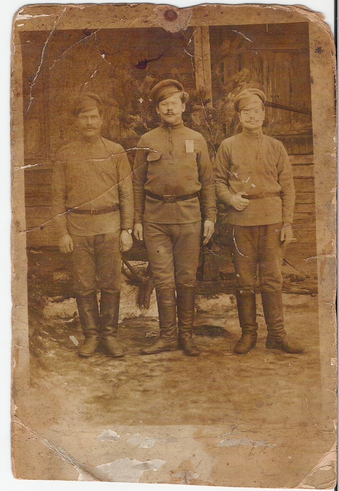
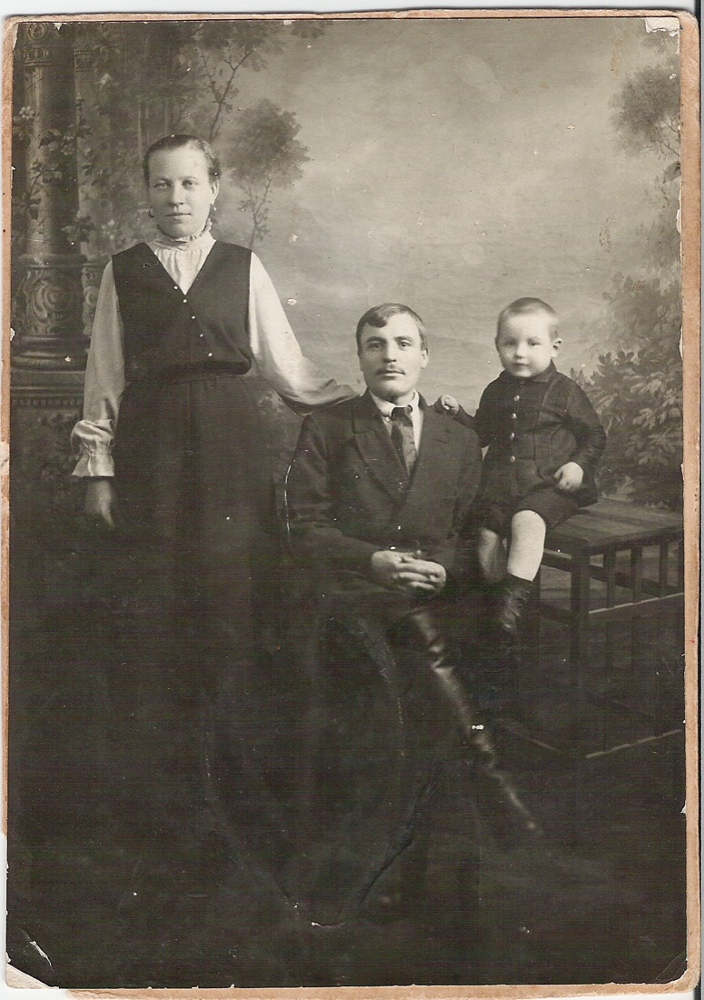
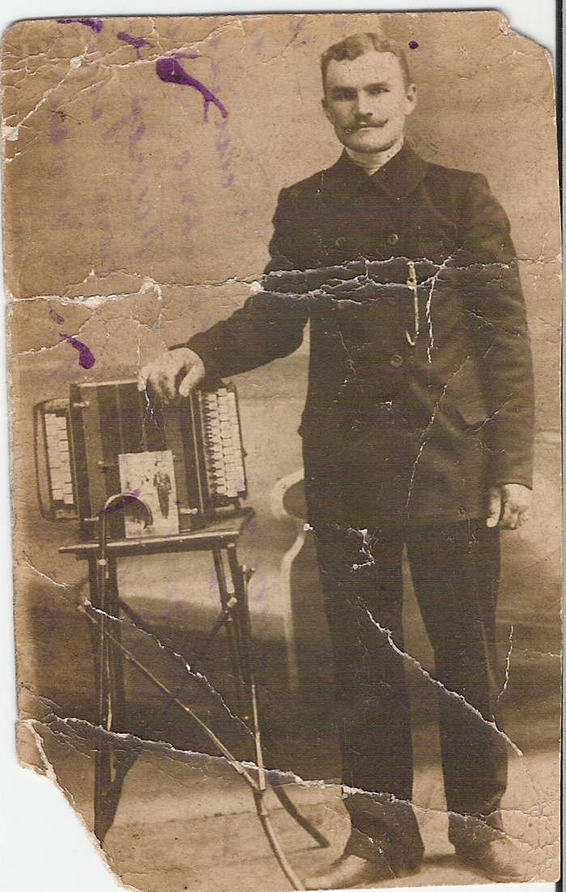

# История семьи — память сквозь поколения

У каждой семьи есть своя история. Она складывается из судеб людей, семейных преданий, старых документов, фотографий и воспоминаний, которые передаются из поколения в поколение.

Этот проект посвящён изучению истории моей семьи, поиску сведений о предках и сохранению памяти о тех, кто жил до нас. Его цель — собрать воедино доступную информацию, восстановить отдельные страницы семейной истории и сделать найденные материалы доступными для всех, кому интересны наши корни.

Здесь будут собраны биографии родственников, исторические документы, архивные материалы, ссылки на источники и другие сведения, помогающие лучше понять прошлое нашей семьи.

Это работа, которая продолжается. Каждый найденный документ, каждая новая деталь и каждое свидетельство могут дополнить общую картину и помочь сохранить то, что иначе со временем могло бы быть утрачено.

Память о прошлом — это связь между поколениями, которую мы можем сохранить для будущего.

## С чего начать

- [Родословное древо](tree.md) — схема родственных связей: кто чей родитель, супруг и ребёнок.
- [Фамилии](surnames/index.md) — фамилии предков: кто их носил и где жили их носители.
- [Персоны](people/index.md) — страницы людей и общий указатель имён.
- [Места](places/index.md) — населённые пункты: административное деление до и после 1917 года и люди, которые там жили.
- [Источники](sources/index.md) — архивные записи, книги и сканы.
- [Генеалогические загадки](genealogy-puzzles.md) — кто кому приходился отцом или братом и один ли это человек: вопросы, для которых пришлось сопоставлять разные документы.
- [Схемы](schemes/index.md) — семейные черты предков, реестр документов по прямым предкам, деревни и приходы на шкале времени.
- [Методология](research-method.md) — насколько надёжны сведения и как прочитаны документы.
- [Терминология](terminology.md) — некоторые термины, встречающиеся в биографиях: например, кто такие удельные и государственные крестьяне, ссыльнокаторжные и поселенцы.
- [О проекте](about.md) — зачем создан сайт и почему это открытая цифровая книга, а не бумажная.

## Биографии

- 1629 — [P1111] — дворцовый крестьянин д. Горелик, отец Афанасия Федотова
- 1645 — [P1061] — крестьянин д. Мышино, глава единственного двора в 1711 г.
- 1648 — [P1062] — крестьянка д. Мышино, жена Михайлы Семенова
- 1649 — [P1069] — дворцовый крестьянин д. Попова Гора, самый ранний предок поповогорской ветви
- 1669 — [P1025] — дворцовый крестьянин д. Зуева (Алексеево-Зуево)
- 1679 — [P1068] — дворцовый крестьянин д. Попова Гора, отец Филиппа Кондратьева
- 1684 — [P1067] — дворцовая крестьянка из д. Горелик, мать Сергея Афанасьева
- 1686 — [P1071] — дворцовая крестьянка д. Попова Гора, мать Филиппа Кондратьева
- 1686 — [P1059] — крестьянин д. Мышино, сын Михайлы Семенова
- 1691 — [P1060] — крестьянка д. Мышино, жена Калины Михайлова
- 1692 — [P1065] — дворцовый крестьянин д. Печохново, дед Анны Никифоровой
- 1693 — [P1072] — дворцовый крестьянин д. Костково, дед Матфея Исакова
- 1694 — [P1066] — дворцовый крестьянин, переведён из д. Горелик в Красихино, отец Сергея Афанасьева
- 1696 — [P1054] — крепостной крестьянин д. Зубово, самый ранний предок зубовской ветви
- 1698 — [P1073] — дворцовая крестьянка из д. Пухово, жена Никифора Никулина
- 1706 — [P1035] — крестьянка д. Мокряне, жена Ильи Абросимова
- 1709 — [P1064] — дворцовая крестьянка из д. Порухово, мать Анны Никифоровой
- 1709 — [P1046] — дворцовая крестьянка д. Маковицы, жена Евтифея Иванова
- 1711 — [P1024] — дворцовый крестьянин д. Алексеево-Зуево
- 1711 — [P1070] — дворцовая крестьянка из д. Саблево, жена Филиппа Кондратьева
- 1712 — [P1086] — жена Данила Астапьева, х. Винники (Харьковская губ.)
- 1714 — [P1023] — дворцовый крестьянин, переведён из д. Колтырево в Маковицы
- 1714 — [P1063] — дворцовый крестьянин д. Печохново, отец Анны Никифоровой
- 1715 — [P1057] — крепостной крестьянин д. Мышино
- 1716 — [P1058] — крепостная крестьянка из д. Кочанова, жена Евдокима Калинина
- 1717 — [P1085] — самый ранний известный предок рода Винник, х. Винники (Харьковская губ.)
- 1718 — [P1034] — крестьянин д. Мокряне, самый ранний известный предок линии Марковых
- 1718 — [P1043] — дворцовый крестьянин д. Попова Гора, глава большого двора
- 1721 — [P1052] — крепостной крестьянин д. Зубово
- 1723 — [P1053] — крепостная крестьянка из сельца Гаркухина, жена Якова Семенова
- 1725 — [P1074] — дворцовый крестьянин д. Костково, отец Матфея Исакова
- 1729 — [P1022] — дворцовая крестьянка из д. Зуева, мать Давыда Федотова
- 1732 — [P1042] — дворцовая крестьянка из д. Ванютина, жена Елисея Филиппова
- 1734 — [P1041] — дворцовый, затем удельный крестьянин д. Попова Гора
- 1735 — [P1032] — крестьянин д. Мокряне, глава большого двора (1806)
- 1735 — [P1009] — дворцовый, затем удельный крестьянин, д. Горелик, затем Захарино
- 1736 — [P1010] — дворцовая, затем удельная крестьянка, жена Сергея Афанасьева, д. Захарино
- 1736 — [P1055] — крепостной крестьянин д. Мышино, отец Екатерины Козьминой
- 1737 — [P1033] — крестьянка д. Мокряне, жена Егора Ильина
- 1738 — [P1056] — крепостная крестьянка из д. Быхнова, жена Козьмы Евдокимова
- 1738 — [P1051] — крепостная крестьянка д. Зубово, мать Ивана Петрова
- 1739 — [P1021] — дворцовый крестьянин д. Маковицы, отец Давыда Федотова
- 1743 — [P1050] — крепостной крестьянин д. Зубово
- 1749 — [P1088] — жена Алексея Данилова Винниченко, х. Винники
- 1751 — [P1087] — сын Данила Астапьева; от него — материнская линия Зои Васильевны
- 1752 — [P1044] — государственный крестьянин д. Костково
- 1753 — [P1045] — государственная крестьянка д. Костково
- 1754 — [P1089] — сын Данила Астапьева; от него — отцовская линия Зои Васильевны
- 1754 — [P1011] — дворцовый, затем удельный крестьянин д. Маковицы; по мнению составителя, от него пошла фамилия Давыдовых
- 1754 — [P1090] — жена Ивана Данилова Винниченко, х. Винники
- 1759 — [P1039] — удельный крестьянин д. Попова Гора
- 1759 — [P1048] — крепостной крестьянин д. Зубово; по предположению, отец Дарьи Ивановой
- 1760 — [P1040] — крестьянка д. Попова Гора, жена Ивана Елисеева
- 1760 — [P1049] — крепостная крестьянка из д. Мышино, жена Ивана Петрова
- 1762 — [P1030] — крепостной крестьянин помещиков Рокотовых, д. Мокряне
- 1764 — [P1031] — крепостная крестьянка д. Мокряне, мать Тита Миронова
- 1767 — [P1012] — дворцовый, затем удельный крестьянин, д. Горелик, затем Захарино
- 1771 — [P1047] — удельная крестьянка д. Маковицы, вторая жена Давыда Федотова
- 1772 — [P1091] — х. Винники, отец Мартина Петрова
- 1784 — [P1038] — крестьянка из д. Костково, вдова в Поповой Горе
- 1786 — [P1037] — удельный крестьянин д. Попова Гора
- 1788 — [P1092] — х. Винники, отец Акима Иванова
- 1793 — [P1029] — крепостная крестьянка из д. Зубова, жена Тита Миронова
- 1795 — [P1028] — крепостной крестьянин д. Мокряне, затем опочецкий мещанин Марков
- 1807 — [P1013] — удельный, затем государственный крестьянин д. Маковицы
- 1808 — [P1036] — крестьянка из д. Попова Гора, жена Космы Потапова
- 1811 — [P1093] — х. Винники, отец Романа Мартынова
- 1812 — [P1094] — жена Мартина Петрова, х. Винники
- 1813 — [P1014] — удельный, затем государственный крестьянин д. Захарино
- 1814 — [P1027] — дочь Тита Миронова, жена Ивана Давыдова из Маковиц
- 1815 — [P1015] — удельный, затем государственный крестьянин д. Маковицы
- 1823 — [P1096] — жена Акима Иванова, х. Винники
- 1825 — [P1095] — х. Винники, отец Иоанна Акимова
- 1840 — [P1016] — государственный крестьянин д. Захарино
- 1840 — [P1097] — крестьянин х. Винники
- 1844 — [P1017] — государственный крестьянин д. Маковицы
- 1853 — [P1098] — военный обыватель х. Винники, «отставной солдат»
- 1855 — [P1000] — ссыльнокаторжная на Сахалине, затем крестьянка в Шевелёвке (Приморье)
- 1858 — [P1001] — каторжный на Сахалине, первый староста д. Шевелёвка
- 1860 — [P1099] — вторая жена Иоанна Акимова, х. Винники
- 1866 — [P1100] — военный обыватель х. Винники, «запасной рядовой»
- 1867 — [P1101] — дочь Емельяна Яковлева Винника, жена Филиппа Романова
- 1873 — [P1019] — крестьянин д. Маковицы, затем упаковщик на ленинградском заводе
- 1875 — [P1018] — крестьянка из д. Захарино, домохозяйка; умерла в блокадном Ленинграде
- 1883 — [P1003] — крестьянка д. Шевелёвка, мать одиннадцати детей
- 1885 — [P1002] — крестьянин-земледелец, родился на Сахалине, жил в Шевелёвке
- 1888 — [P1103] — жена Акима Иоаннова Винника
- 1889 — [P1020] — сын государственного крестьянина д. Маковицы; по семейным преданиям — участник Первой мировой войны
- 1890 — [P1102] — х. Винники, отец Василия Акимовича
- 1890 — [P1081] — дочь Анисима Харламенко, мать Марии Васильевны Березовской; умерла в Тюмени
- 1893 — [P1104] — х. Винники, умер весной 1933 г.
- 1897 — [P1105] — жена Ивана Филипповича Винника, затем Павла Ляшенко
- 1911 — [P1106] — х. Винники; муж Полины Ивановны, отец семерых детей
- 1916 — [P1005] — участник Курильского десанта, партийный работник на Камчатке
- 1917 — [P1107] — х. Винники; умерла в с. Литовки Харьковской обл.
- 1919 — [P1080] — жена Григория Писарева; в 1942 г. с сыном в Омской области, позже — на Дальнем Востоке и в Тюмени
- 1919 — [P1007] — шофёр понтонно-мостового полка, погиб в 1943 г.
- 1924 — [P1006] — учительница в Петропавловске-Камчатском
- 1956 — [P1108] — урожд. Винник, потомок Данила Астапьева по обеим линиям; Харьков
- [P1084] — отец Марии Васильевны Березовской
- [P1083] — муж Марии Анисимовны Харламенко; жил в д. Дрогачево Нелидовского района
- [P1078] — крестьянин-хлебопашец д. Глазки, отец Григория Писарева
- [P1075] — дворцовая крестьянка из д. Боравова, жена Исаака Никифорова
- [P1008] — крестьянин д. Шевелёвка
- [P1082] — отец Марии Анисимовны Харламенко
