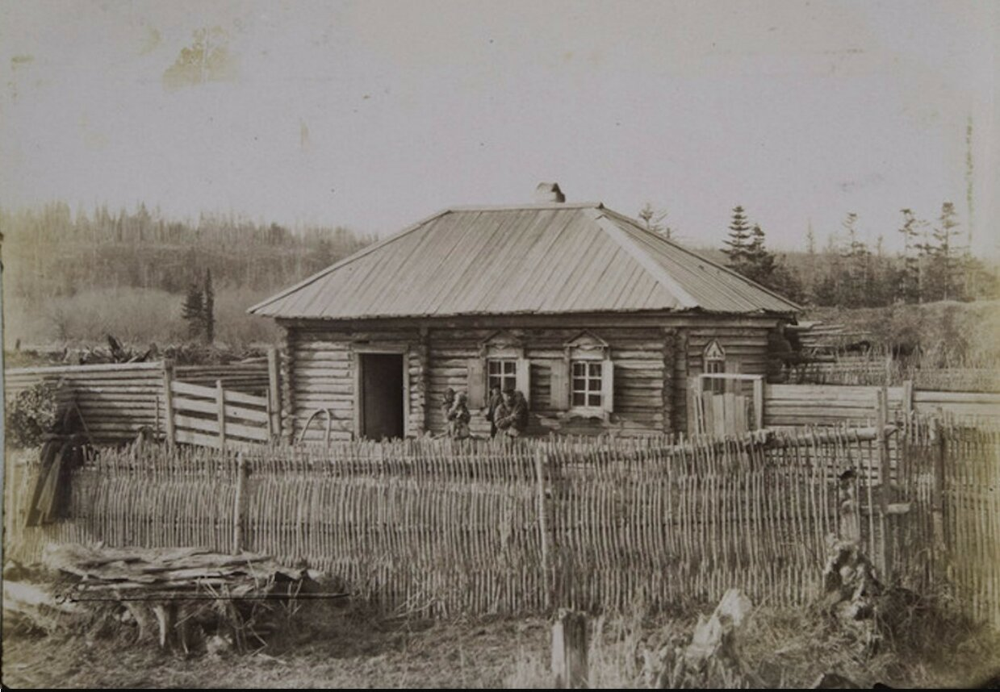
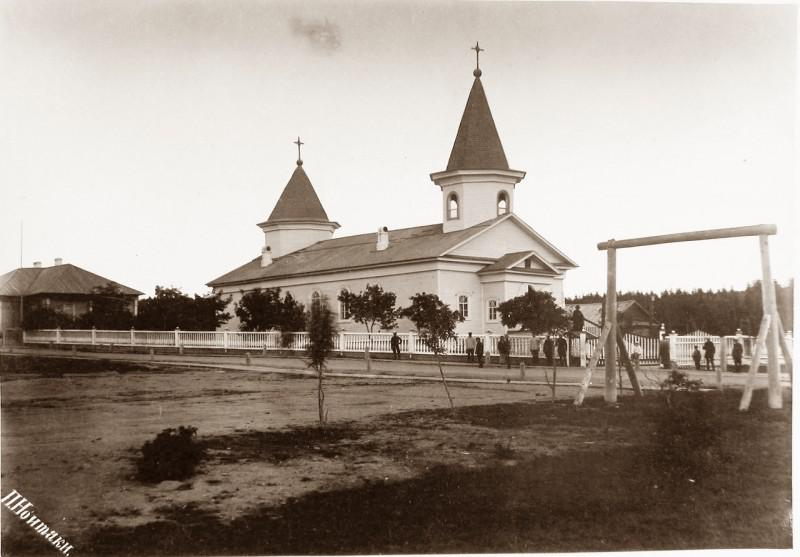

# Егор (Георгий) Димитриев Почеревин (ок. 1858–1860 – до 1938)

Егор Почеревин попал на Сахалин каторжным. В январе 1891 года его освободили от каторжных работ, и он стал ссыльнопоселенцем Корсаковского округа на юге острова [A1011]. Жил в селении Соловьевка, где в 1895 году женился на ссыльнопоселенке [Евдокии Лапиной](P1000) и в том же году был перечислен в крестьяне [A1006][A1012]. В 1905 году вместе с другими бывшими сахалинцами он переселился на материк, в Приморье, в деревню [Шевелёвка](PLC1000). В 1907 году односельчане выбрали его первым сельским старостой Шевелёвки [A1016][A1018]. Умер, по-видимому, до 1938 года. Его пасынок — [Иван Егорович Почеревин](P1002), сын Евдокии.

## Краткие сведения

- **Родился:** около 1858–1860 г.; место рождения неизвестно. Возраст по документам: 34 года в 1894 г. [A1005], 36 лет в январе 1895 г. [A1006].
- **Звание:** ссыльнокаторжный; ссыльнопоселенец Корсаковского округа с 12 января 1891 г. [A1011]; крестьянин из ссыльных с 13 июля 1895 г. [A1012]; крестьянин [д. Шевелёвка](PLC1000) (Приморье) с 1905 г. (после 23 января, по-видимому, в конце года) [A1015][A1016][A1017].
- **Места жительства:** Корсаковский округ о. Сахалин, селение Соловьевка (документально — 1894–1895 гг.) [A1005][A1006]; д. Шевелёвка Цемухинской волости в Приморье (1905 – не ранее 1907 г., возможно — до 1917 г.) [A1016][A1019][A1031].
- **Жена:** [Евдокия Артемьевна Лапина](P1000), венчание 15 января 1895 г.; для него — «первымъ бракомъ» [A1006].
- **Пасынок:** [Иван (Иоанн) Егорович Почеревин](P1002), р. 15 июля 1885 г.
- **Общественная должность:** сельский староста Шевелёвки, избран 11 февраля 1907 г. [A1018].
- **Умер:** дата и место неизвестны; по ответу архива, полученному составителем, — до 1938 г.

## Каторга и поселение на Сахалине (до 1895)

Откуда Егор Почеревин родом, за что и когда он был осуждён, в имеющихся источниках не сказано. Первое документальное свидетельство о нём — «Алфавит ссыльнопоселенцев о-ва Сахалина». В эту книгу записывали каторжных, которых освободили от работ и перевели в поселенцы. Строка о нём выглядит так [A1011]:

> | № по порядку | Имена, фамилии и семейства поселенцев | Время увольнения от работ: временного | окончательного | В каком селении состоит на причислении |
> |---|---|---|---|---|
> | 265 / 151 | Почеревинъ Егоръ | | 12 Января 91 г. | Корс. |

Значит, 12 января 1891 года он был окончательно уволен от каторжных работ и причислен к Корсаковскому округу. С этого дня он стал ссыльнопоселенцем: жил на воле в одном из селений, вёл своё хозяйство, но покинуть остров не имел права. Вторая графа алфавита называется «Имена, фамилии и семейства поселенцев», но из того, что в ней стоит только его имя, нельзя заключить, что семьи у него не было. Членов семьи в такие алфавиты, по-видимому, просто не вписывали: в похожем крестьянском алфавите 1896 года у его жены Евдокии тоже записано одно имя, хотя у неё тогда уже были муж и сын [A1007]. Женат Егор до 1895 года, впрочем, не был: в записи о браке он венчается «первымъ бракомъ» [A1006].

Осенью 1890 года, за несколько месяцев до этого, на Сахалине побывал А. П. Чехов и переписал всё население острова. В переписи селения Соловьевка Почеревина нет [B1000]. По-видимому, он был тогда ещё каторжным и жил при тюрьме или в другом месте; документами это не подтверждено.

Как выглядели дома ссыльнопоселенцев Соловьевки, видно на снимке конца 1880-х годов [F1000]:

Селение Соловьевка относилось к приходу Анивской церкви во имя Святителя Николая Чудотворца в посту Корсаковском — главном селении южного Сахалина [F1001]. В метрических книгах этой церкви записаны все известные церковные события сахалинской жизни Почеревиных: венчание, крещения, где они были крёстными, свадьбы, где они были поручителями. Деревянный храм с двумя шатровыми башенками стоял за белой оградой; так он выглядел в 1891 году:

В исповедной росписи Анивской церкви за 1894 год он записан как «Почеревин Георгий Йосипов», 34 лет, в восьмом дворе селения Соловьевка. Он стоит в этом дворе первым. В том же дворе записаны ссыльнокаторжная Евдокия Артемиева Лапина, 39 лет, с сыном Иоанном, 8 лет, семья фельдшера Василия Симеонова Погорелова и Анастасия Пырченкова с дочерью [A1005]. Исповедную роспись священник составлял каждый год: переписывал прихожан по дворам и отмечал, кто был у исповеди. Георгий — церковная форма имени Егор. Отчество в росписи — «Йосипов», а не «Димитриев», как в записи о браке (см. «Замечания о документах»).

## Брак и перечисление в крестьяне (1895)

15 января 1895 года в Анивской церкви он обвенчался с Евдокией Лапиной. Согласно записи № 2 в метрической книге, жених — «Ссыльно-поселенецъ Корсаковскаго Округа поселенія Соловьевка Егоръ Димитріевъ Почеревинъ, православнаго вѣроисповѣданія, первымъ бракомъ», 36 лет. Невеста — «Ссыльно-поселенка селенія Соловьевка Евдокія Артемьева Лапина, православнаго вѣроисповѣданія, вторымъ бракомъ послѣ расторженія» [A1006]. Поручители со стороны жениха: «ссыльно-поселенецъ селенія Соловьевка Осипъ Юхнюкъ и сс. каторжный Корсаковской тюрьмы Иванъ Рѣшетникъ»; со стороны невесты — поселенец Константин Павлов Пирамидин и крестьянин Соловьевки Василий Погорелов [A1006]. Венчал священник Дмитрий Пенчиков. Этот брак отмечен и в алфавитном указателе к метрическим книгам Анивской церкви за 1895–1905 годы: «Егор Почеревин Дмитриевич … 1895 … брак» [A1010].

Через полгода, 13 июля 1895 года, его перечислили из поселенцев в крестьяне. Об этом есть запись в алфавите ссыльных, перечисленных в крестьяне [A1012]:

> | №№ по порядку и алфавитов статейных списков | Фамилии и имена | Время перечисления в крестьяне | Какого округа | Убыл за смертию, переведен с о. Сахалина… |
> |---|---|---|---|---|
> | 226 / 151 об. | Почеревинъ Егоръ | 13 Июля 95 г. № 133 | К. О. | |

«№ 133» — по-видимому, номер приказа, «К. О.» — Корсаковский округ. Номер 151 в алфавите статейных списков тот же, что в записи 1891 года, — значит, это один и тот же человек [A1011][A1012]. Жену Евдокию перечислили в крестьяне позже, 4 апреля 1896 года [A1007].

По закону поселенец становился крестьянином только через десять лет, а Егор стал им через четыре с половиной года. Возможно, срок ему сократили по манифесту 14 ноября 1894 года, изданному по случаю бракосочетания Николая II. Пункт 11 манифеста разрешал «сокращать назначенный законом для перечисления ссыльнопоселенцев в крестьяне десятилетний срок для тех из них, которые в течение четырех лет вели себя одобрительно и занимались полезным трудом» [B1006]. Сроки Егора с этим совпадают, но прямой ссылки на манифест в записи о нём нет.

Звание «крестьянин из ссыльных» было следующей ступенью после поселенца. Такой крестьянин мог уехать с Сахалина и поселиться в Сибири или на Дальнем Востоке, но не в Европейской России. Почеревины, однако, остались в Соловьевке ещё на десять лет.

## Последние сахалинские годы (1895–1905)

О самом Егоре с 1895 по 1905 год документов нет. Но в 1903–1905 годах в метрических книгах Анивской церкви трижды появляется его пасынок — уже под фамилией Почеревин и с отчеством по отчиму. Он записан крёстным и поручителем: «Крестьянинъ свободнаго состоянія Иванъ Егоровъ Почеревинъ» (1903) [A1013], «крестьянинъ Иванъ Егоровъ Почеревинъ» (1904) [A1014], «Селенія Саловьевки Крестьянинъ свободнаго состоянія Іоаннъ Георгіевъ Почеревинъ» (1905) [A1015]. Подробнее — в биографии [P1002].

Связи этих лет потом продолжились в Приморье. В 1904 году Иван был поручителем на свадьбе Степана Иосифова Юхнюка [A1014] — по-видимому, сына того Осипа Юхнюка, который в 1895 году был поручителем на свадьбе самого Егора [A1006]. Вторым поручителем там был крестьянин Андрей Андреев Рудзит [A1014]. Через год Рудзит вместе с Почеревиными оказался среди первых жителей Шевелёвки [A1016].

## Переселение в Приморье (1905)

Во время русско-японской войны, летом 1905 года, Сахалин заняли японские войска. По Портсмутскому мирному договору (август 1905 г.) южная часть острова, где стояли Корсаков и Соловьевка, отошла Японии. Многие жители юга Сахалина переселились на материк. В каких именно обстоятельствах уехали Почеревины, документы не говорят. Краевед Ю. А. Тарасов пишет о Шевелёвке, что «как минимум, четыре из этих семей прибыли в Шевелевку в самом конце 1905 года с южного Сахалина, после оккупации его японцами, и жили, очевидно, в домах местных крестьян» [B1002]. Имён этих семей он не называет.

В деле Южно-Уссурийского переселенческого управления «об образовании новых селений в Южно-Уссурийском крае» (начато 10 мая 1905 г., окончено 28 февраля 1906 г.) подшит «Списокъ бывшихъ обывателей острова Сахалина, водворенныхъ въ селеніи Шевелевкѣ, … Цемухинской волости, Южно-Уссурійскаго уѣзда, получившихъ ссуду на домообзаведеніе». В нём шестнадцать фамилий; двенадцатая — «Почеревинъ Егоръ», ссуда 100 рублей [A1016]. Ссуда на домообзаведение — казённые деньги переселенцу на постройку дома и хозяйство.

Шевелёвка была тогда совсем молодой деревней. По данным Тарасова, она возникла в 1903 году на переселенческом участке № 100 «Сухая речка», когда там поселились первые шесть семей; к 1 января 1906 года в ней стояло всего девять усадеб [B1002]. Позднее деревня вошла в черту города Артёма; официально Шевелёвка перестала существовать в 1972 году, и сейчас о ней напоминает название одного из артёмовских кладбищ [B1002]. В том же списке — «Погорѣловъ Василій» (200 руб.), по-видимому, тот самый фельдшер из соседнего двора в Соловьевке, и «Рудзитъ Андрей» (200 руб.) [A1016][A1005]. Это вывод по совпадению имён, а не прямое свидетельство.

10 декабря 1905 года чиновник особых поручений отправил заведующему переселенческим делом в Приамурском крае «списки сахалинцевъ 1905 г., первоначально водворенныхъ въ с. Шевелевку» [A1017]. Часть из них позже перевели на другие участки, но Почеревины остались в Шевелёвке [A1018][A1019].

Когда именно Почеревины покинули Сахалин, можно определить по последней записи о них в Соловьевке. 23 января 1905 года пасынок Егора, Иван, ещё записан крёстным как «Селенія Саловьевки Крестьянинъ свободнаго состоянія Іоаннъ Георгіевъ Почеревинъ» [A1015]. Значит, переезд пришёлся на 1905 год — после 23 января, по-видимому, в конце года. Это согласуется с донесением от 10 декабря 1905 года [A1017] и с наблюдением Тарасова, что сахалинские семьи прибыли в Шевелёвку «в самом конце 1905 года» [B1002]. По заметкам составителя родословия, переезд был в 1906 году.

## Сельский староста Шевелёвки (1907)

11 февраля 1907 года переселенцы Шевелёвки составили «Приговор об образовании сельского общества». Приговор здесь — решение сельского схода, а не суда. Документ хранится в РГИА ДВ и опубликован в сборнике «Из истории заселения Шкотовского района» (2017). В нём сказано [A1018]:

> Мы, нижеподписавшиеся переселенцы, вследствие предложения заведующего водворением переселенцев в Побережном подрайоне об образовании общества, наименовании поселка и выборе должностных лиц, постановили: 1) образовать общество из 14 водворившихся домохозяев: Киприана Киселькова, Марка Следнева, Никиты Сычева, Ивана Скубовского, Алексея Беккера, Сергея Бережного, Семена Давыдок, Дмитрия Коржа, Василия Максимова, Егора Подчеревина, Николая Поздеева, Бориса Печенева, Андрея Рудзита и Андрея Хотинца; 2) наименовать селение «Шевелевкой»; 3) избрать: сельским старостой Егора Подчеревина, кандидатом к нему Семена Давыдок, писарем Алексея Беккер.

Так Егор Почеревин стал первым сельским старостой Шевелёвки — выборным главой сельского общества. Приговор утвердило Приморское областное по крестьянским делам присутствие: 19 марта 1907 года оно постановило «Утвердить на переселенческом участке № 100 «Сухая речка» образование отдельного сельского общества под названием «Шевелевка» на 111 душевых долей и включить его в состав Цемухинской волости» [B1002]. Тарасов называет это вторым рождением деревни. Кандидат к старосте — его заместитель. Сам он был неграмотным: под приговором за него и других неграмотных «и по их личной просьбе» расписался писарь Алексей Беккер [A1018]. Среди четырнадцати домохозяев — Никита Сычев, отец Анны Никитичны, на которой в октябре 1906 года женился пасынок Егора Иван [A1020].

Через месяц, 15 марта 1907 года, был составлен «Списокъ зачисленныхъ на уч[астокъ] Шевелевскій» — список переселенцев, зачисленных на этот переселенческий участок. Он подшит в дело заведующего переселенцами о водворившихся по селениям Цемухинской волости [A1019]. Те же четырнадцать хозяев стоят в нём в том же порядке; десятый — «Егоръ Почеревинъ», в хозяйстве две души, третий — «Никита Сычевъ», отец невестки Егора (жены пасынка Ивана), семь душ [A1019]. Кто именно учтён в этих двух душах, список не говорит. Пасынок Иван к тому времени женился (4 октября 1906 года) и, возможно, числился отдельно [A1020].

## Последние годы

4 декабря 1908 года жена Егора, Евдокия, была крёстной матерью Екатерины, дочери Никиты Сычева. В записи она названа «крест[ьянская] жена Евдокия Андреева Почеревина» [A1008]. «Жена», а не «вдова», — значит, Егор, по-видимому, был тогда жив.

Под приговором сельского схода Шевелёвки 22 мая 1913 года подписи Егора нет, а Иван («Иван Подчеревин») есть [A1029]. На сходе было 31 домохозяин из 36, поэтому вывода из этого сделать нельзя.

15 апреля 1917 года поручителем по невесте на свадьбе в Шкотовской церкви был «гражд[анин] д. Шевелёвки Егор Иоаннов Почеревин» [A1031]. Других Егоров Почеревиных в Шевелёвке документы не знают, но отчество «Иоаннов» не совпадает ни с «Димитриевым», ни с «Йосиповым». Он ли это, остаётся неясным.

Жена Евдокия умерла 17/30 июня 1921 года: «Гражд. д. Шевелёвки Евдокия Почеровина – 70л. (старости)» [A1009]. Записи о смерти Егора не найдено. По ответу архива (получен составителем в августе 2025 г.), в похозяйственных книгах Шевелёвки 1938 года Егор Почеревин уже не значится. Значит, он умер (или уехал) раньше.

## Семья

- **Жена** — [Евдокия Артемьевна Лапина](P1000) (ок. 1855 – 1921), ссыльнокаторжная, затем ссыльнопоселенка и крестьянка; венчание 15.01.1895, для неё — второй брак [A1006][A1009].
- **Пасынок** — [Иван (Иоанн) Егорович (Георгиевич) Почеревин](P1002), р. 15.07.1885 в Соловьевке, сын Евдокии; с 1903 г. носит фамилию Почеревин и отчество по отчиму [A1000][A1013].
- **Собственные дети** в документах не упоминаются.
- **Внуки** (дети Ивана и Анны Никитичны Почеревиных) — см. [P1002]; младшая внучка — [Любовь Ивановна Давыдова (Почеревина)](P1006).

## Хронология

| Дата | Событие | Место | Звание | Источник |
|---|---|---|---|---|
| ок. 1858–1860 | Рождение | неизвестно | — | [A1005][A1006] |
| 14.09–10.10.1890 | В переписи Чехова в Соловьевке не значится | Соловьевка, Сахалин | — | [B1000] |
| 12.01.1891 | Окончательно уволен от каторжных работ | Корсаковский округ | ссыльнопоселенец | [A1011] |
| 1894 | Исповедная роспись: «Почеревин Георгий Йосипов», 34 лет, двор 8 | Соловьевка | — | [A1005] |
| 15.01.1895 | Брак с Евдокией Лапиной («первымъ бракомъ»), 36 лет | Анивская церковь, Соловьевка | ссыльнопоселенец | [A1006][A1010] |
| 13.07.1895 | Перечислен в крестьяне (приказ № 133) | Корсаковский округ | крестьянин из ссыльных | [A1012] |
| 1905 (после 23.01, по-видимому, в конце года) | Водворён в Шевелёвке, ссуда на домообзаведение 100 руб. | Шевелёвка, Цемухинская вол., Южно-Уссурийский у. | бывший обыватель о. Сахалина | [A1016][A1017] |
| 11.02.1907 | Избран сельским старостой при образовании сельского общества | Шевелёвка | переселенец | [A1018] |
| 15.03.1907 | Список зачисленных на участок Шевелёвский: № 10, 2 души | Шевелёвка | — | [A1019] |
| 04.12.1908 | Жена — крёстная Екатерины Сычевой, названа «крест. жена» | Шевелёвка | крестьянин | [A1008] |
| 15.04.1917 | «Егор Иоаннов Почеревин» — поручитель на свадьбе (он ли это — неясно) | Шкотовская церковь | гражданин | [A1031] |
| 17/30.06.1921 | Смерть жены | Шевелёвка | — | [A1009] |
| до 1938 | Смерть (в похозяйственных книгах 1938 г. не значится; по ответу архива, полученному составителем) | — | — | ответ архива (у составителя) |

## Как он назван в документах

| Как записан | Документ |
|---|---|
| Почеревинъ Егоръ | алфавит поселенцев 1891 г. [A1011]; алфавит 1895 г. [A1012]; список 1905 г. [A1016]; список 1907 г. [A1019] |
| Почеревин Георгий Йосипов | исповедная роспись 1894 г. [A1005] |
| Егоръ Димитріевъ Почеревинъ | запись о браке 1895 г. [A1006] |
| Егор Почеревин Дмитриевич | алфавитный указатель к метрическим книгам 1895–1905 гг. [A1010] |
| Егор Подчеревин | приговор 1907 г. (в публикации) [A1018] |
| Егор Иоаннов Почеревин | запись о браке 1917 г. (тождество не установлено) [A1031] |

## Замечания о документах

- **Отчество.** В записи о браке 1895 г. — «Димитриев» [A1006], в исповедной росписи 1894 г. — «Йосипов» [A1005], в записи 1917 г. (если это он) — «Иоаннов» [A1031]. В семейном предании Егор назван «предположительно Егоровичем»; документами это не подтверждается.
- **Имя.** Егор и Георгий — одно имя: Георгий — церковная форма, Егор — народная. Поэтому пасынок записан то «Егоровым», то «Георгиевым».
- **Год рождения.** 34 года в 1894 г. — около 1860 г.; 36 лет в январе 1895 г. — около 1858–1859 г.
- **Каторга.** О самом осуждении документов нет. То, что он был каторжным, следует из записи об «увольнении от работ» в алфавите поселенцев [A1011].
- **Цитаты по скану и распознаванию.** Строки алфавитов 1891 и 1895 гг. и списков 1905 и 1907 гг. прочитаны по сканам из личной коллекции составителя; несколько слов в примечаниях списка 1905 г. и почти весь текст письма 1905 г. [A1017] прочитаны неуверенно. Запись о браке 1895 г. — распознавание Яндекс Архива. Приговор 1907 г. цитируется по публикации [A1018][B1001]. Записи Шкотовской церкви [A1008][A1009][A1020][A1031] — по расшифровкам с форума ВГД; сканы этих записей найти не удалось.
- **Архивный шифр списка 1907 г.** [A1019] установлен по фотографии обложки дела: оп. 1, д. 18, фонд бывшего ЦГИА РСФСР ДВ (ныне РГИА ДВ); номер фонда (440 или 490) читается неуверенно, его нужно проверить в архиве.
- **Дата переезда.** По заметкам составителя — 1906 г. По документам — 1905 г.: после 23 января (последняя запись в Соловьевке [A1015]), по-видимому, в конце года [A1016][A1017][B1002]. Сам список сахалинцев [A1016] не датирован.
- **Год смерти.** Известен только верхний предел (1938 г.) — по ответу архива, который есть у составителя. Записи о смерти не найдено.
- **Место происхождения и преступление** — неизвестны.

## Исследовательские заметки

- **Статейный список.** В обоих алфавитах у него стоит номер 151 «по алфавиту статейных списков» [A1011][A1012]. Статейный список — личное дело ссыльного с приметами, происхождением и приговором. Если такие списки Корсаковского округа сохранились (вероятно, в РГИА ДВ, ф. 1133), по этому номеру можно попытаться найти, откуда Егор родом и за что осуждён.
- **Предположение (не подтверждено документами).** «Михаилъ Погорѣловъ» в шевелёвском списке 1907 г. [A1019] может быть сыном соседа Почеревиных по Соловьевке, фельдшера Вас. Сем. Погорелова [A1005]. В списке о нём отмечено: «Водворившійся отецъ умеръ, сынъ — несовершеннолѣтній». Чтение фамилии неуверенное.
- Записи Шкотовской церкви об умерших за 1921–1923 гг. и похозяйственные книги Шевелёвки 1920-х — 1930-х гг. — место для поиска даты смерти Егора.

## Источники

- [A1011] — алфавит ссыльнопоселенцев: увольнение от каторжных работ, 1891 г.
- [B1000] — Сахалинская перепись А. П. Чехова, 1890 г. (в Соловьевке не значится)
- [A1005] — исповедная роспись Анивской церкви, Соловьевка, 1894 г.
- [A1006] — запись о браке с Евд. Арт. Лапиной, 1895 г.
- [A1010] — алфавитный указатель к метрическим книгам Анивской церкви, 1895–1905 гг.
- [A1012] — алфавит ссыльных, перечисленных в крестьяне, 1895 г.
- [B1006] — манифест 14 ноября 1894 г. о милостях (сокращение срока для перечисления в крестьяне)
- [F1000] — изба поселенца в Соловьевке, 1888–1890 гг. (иллюстрация)
- [F1001] — Анивская церковь в посту Корсаковском, 1891 г. (иллюстрация)
- [A1013], [A1014], [A1015] — пасынок Иван Егоров Почеревин в метрических книгах Анивской церкви, 1903–1905 гг.
- [A1016] — список бывших сахалинцев, водворённых в Шевелёвке, 1905 г.
- [A1017] — донесение о сахалинцах, водворённых в Шевелёвке, 10.12.1905
- [A1018] — приговор об образовании сельского общества Шевелёвка, 11.02.1907
- [A1019] — список зачисленных на участок Шевелёвский, 15.03.1907
- [A1020] — брак пасынка Ивана с Анной Сычевой, 1906 г.
- [A1008] — жена — крёстная Екатерины Сычевой, 1908 г.
- [A1029] — список домохозяев Шевелёвки, 1913 г.
- [A1031] — «Егор Иоаннов Почеревин» — поручитель на свадьбе, 1917 г.
- [A1009] — смерть жены, 1921 г.
- [B1002] — Ю. А. Тарасов, «Артем на заре своей истории» (2006), раздел «Шевелевка»
- Ответ архива о похозяйственных книгах Шевелёвки 1938 г. (у составителя, не публикуется)

## Связанные персоны

- Жена — [P1000]
- Пасынок — [P1002]
- Внучка — [P1006]
- Сват (отец невестки) — [P1008]
