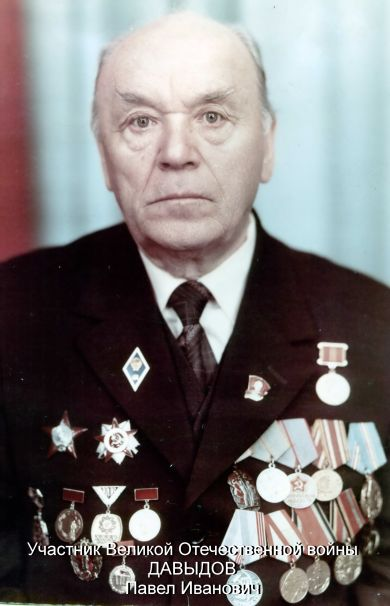

# Павел Иванович Давыдов (1916 – 2002)

{ align=right width="240" }

Павел Иванович Давыдов родился в 1916 году в крестьянской семье в деревне [Маковицы](PLC1002) Псковской губернии. Подростком переехал с родителями в Ленинград, работал бухгалтером, а в 1938 году уехал на Камчатку. Прошёл войну в 101-й стрелковой дивизии, которая охраняла Камчатку: был политруком и парторгом, в августе 1945 года участвовал в Курильской десантной операции. Около тридцати лет он работал на партийных должностях на Камчатке, а потом руководил областным Советом ветеранов. Умер в 2002 году. Его жена — [Любовь Ивановна Давыдова (Почеревина)](P1006) [A1037].

## Краткие сведения

- **Родился:** 22 июня 1916 г., [дер. Маковицы](PLC1002) Пушкинского (Пушкиногорского) района Псковской области (тогда — Псковская губерния) [A1119][D1000][A1037][DB1000].
- **Родители:** отец — [Иван Васильевич Давыдов](P1019), крестьянин-середняк, в Ленинграде упаковщик завода «Пролетарий», умер в 1935 г.; мать — [Александра Андреевна Андреева](P1018), домохозяйка, умерла в 1942 г. в блокадном Ленинграде [A1037]. В метрической книге Христорождественской церкви погоста Рождество за 1916 г.: «крестьянинъ Іоаннъ Васильевъ Давыдовъ и жена его по первымъ бракомъ Александра Андреевна» [A1119]; в свидетельстве о рождении, выданном повторно в 1930-е гг., — «Давыдов Иван Васильевич» и «Андреева Александра Андреевна» [D1000].
- **Крещение:** 23 июня 1916 г., Христорождественская церковь погоста Рождество; крёстные — крестьянин Василий Корнилиев и девица Анна Васильева из д. Костина [A1119].
- **Братья и сёстры:** старший брат и сестра, жили в Ленинграде (в справке архива имена не названы) [A1037]; по семейным преданиям — Александр (р. 1899) и Мария (р. 1906) [A1107][A1112]; по метрическим книгам у родителей с 1897 по 1912 г. родились Иоанн, Анастасия, Александр, Любовь, Виктор, Мария, Анатолий и Зинаида; несколько из них умерли в младенчестве [A1104]–[A1117].
- **Образование:** вечерняя школа и двухгодичные курсы бухгалтеров-финансистов (Ленинград, 1931–1938); Хабаровская краевая партийная школа (1953–1956) [A1037].
- **Военная служба:** 9 июля 1941 – 1949 г., 101-я стрелковая дивизия; последнее звание по данным Министерства обороны — майор [DB1000].
- **Награды:** орден Красной Звезды (1945), орден «Знак Почёта», медали «За победу над Японией», «За боевые заслуги» и другие [A1037].
- **Жена:** [Любовь Ивановна Давыдова](P1006), урождённая Почеревина (1924–1991), брак 09.06.1945, Усть-Большерецкий район Камчатской области [D1008][A1037].
- **Дети:** дочь Лариса Павловна (р. 1946), в замужестве Писарева — жена [Валерия Григорьевича Писарева](P1109); сын Сергей (р. 1951) (по сведениям составителя).
- **Умер:** 16 июня 2002 г.; по справке архива, «похоронен здесь» — по-видимому, в Петропавловске-Камчатском [A1037].

## Детство и юность (1916–1938)

В исторической справке Камчатского архива сказано: «Давыдов Павел Иванович родился 22 июня 1916 года в семье крестьянина-середняка в дер. Маковицы Пушкинского района Псковской области» [A1037]. «Середняк» — в советской классификации крестьянин со средним достатком: не бедняк и не кулак. В карточке ЦАМО (Центрального архива Министерства обороны) место рождения записано как «Псковская обл., Пушкино-Горский р-н, д. Маковица» [DB1000]. Это Псковская губерния, места рядом с Пушкинскими Горами.

«В 1930 году родители переехали жить в г. Ленинград, отец работал на заводе "Пролетарий" упаковщиком, мать-домохозяйка. В 1935 году отец умер, мать после смерти отца переехала жить к старшему брату Давыдова Павла Ивановича, а затем к сестре. В 1942 году, в период блокады Ленинграда, мать умерла» [A1037].

Работать Павел начал в 15 лет. В 1931 году он поступил на завод «Пирометр» учеником бухгалтера, потом работал там счетоводом и бухгалтером. В 1934 году вступил в комсомол (ВЛКСМ). С 1935 года до апреля 1937 года был бухгалтером-финансистом на Металлическом заводе, затем до июня 1938 года — заместителем главного бухгалтера на заводе «Производство знаков». Одновременно, с 1931 по 1938 год, он учился. В справке архива сказано о вечерней школе и двухгодичных курсах бухгалтеров-финансистов [A1037], а сам Павел Иванович в автобиографии пишет: «По окончании вечернего финансово-экономического техникума в 1938 г. выехал на Дальний Восток» [W1000].

В Ленинграде жили и другие Давыдовы. Составитель нашёл в адресной книге «Весь Ленинград» на 1934 год Давыдова Михаила Васильевича, бухгалтера, и Давыдова Александра Ивановича — оба по адресу Кондратьевский пр., 9а, корп. 6, кв. 18. Очень вероятно, что это дядя Павла, [Михаил Васильевич](P1020), и его старший брат Александр (р. 1899) [A1107], но других доказательств, кроме совпадения имён и общего адреса, нет. По рассказам самого Павла Ивановича, они все работали на заводе «Производство знаков» (или «Пирометр»).

## Камчатка до войны (1938–1941)

«В 1938 году выехал на Камчатку» [A1037]. С июня 1938 года по сентябрь 1939 года Павел работал старшим бухгалтером Колпаковского рыбокомбината АКО в Усть-Большерецком районе на западном побережье Камчатки [A1037][W1000]. АКО — Акционерное Камчатское общество, государственная компания, которая в 1927–1945 годах вела рыбный промысел и снабжение на Камчатке. С сентября 1939 года он был помощником начальника политотдела по комсомолу и секретарём комсомольской организации того же рыбокомбината. Когда политотделы упразднили, его направили в Камчатский обком ВЛКСМ. Там он заведовал военно-физкультурным отделом и был членом бюро обкома [A1037].

## Война (1941–1945)

9 июля 1941 года Павла Давыдова призвали в армию, в 101-ю стрелковую дивизию [W1000][DB1000]. Эта дивизия всю войну стояла на Камчатке и охраняла побережье от возможного нападения Японии. Сначала он служил красноармейцем и секретарём военного трибунала дивизии. В августе 1941 года вступил в партию, партийный билет № 00422035 [A1037]. В автобиографии он добавляет, что до июля 1942 года служил «рядовым - секретарем военного трибунала 101 стрелковой дивизии. За это время окончил дивизионную одногодичную партийную школу» [W1000].

В июле 1942 года его назначили политруком роты автоматчиков 198-го стрелкового полка 101-й дивизии. Политрук — политический руководитель, отвечал за «партийно-политическую работу» и настроение бойцов. Осенью 1942 года институт политруков рот упразднили, и с октября 1942 по июнь 1943 года он был заместителем командира роты автоматчиков по политчасти. С июня 1943 по июль 1944 года был парторгом 1-го стрелкового батальона, а с 1944 года — парторгом всего 198-го стрелкового полка [A1037]. По автобиографии, парторгом полка его в июле 1944 года назначило политуправление Дальневосточного фронта, и на этой должности он оставался до ноября 1946 года. С сентября 1943 года его трижды избирали членом и заместителем секретаря дивизионной парткомиссии [W1000].

В том же 198-м полку служил его ровесник Василий Андреевич Кот, будущий Герой Советского Союза. Он прибыл в полк в октябре 1940 года, был политруком роты, с ноября 1942 года — парторгом полка, а с 1944 года — старшим инструктором политотдела 101-й дивизии [W1004][W1005]. Биография Кота есть и на сайте «Герои страны»: [warheroes.ru](https://www.warheroes.ru/hero/hero.asp?Hero_id=7315). Так что несколько лет Давыдов и Кот были политработниками одного полка; как и Давыдов, Кот до армии работал бухгалтером. Парторгом полка Давыдов стал в том же 1944 году, когда Кот перешёл в политотдел дивизии.

9 июня 1945 года Павел Иванович женился на Любови Ивановне Почеревиной. Брак зарегистрировали в бюро ЗАГС при поселковом совете им. Микояна Усть-Большерецкого района Камчатской области: «Гр. **Давыдов**{.subject} … **Павел Иванович**{.subject}, Гр-ка Почеревина … Любовь Ивановна вступили в брак»; после брака жена взяла его фамилию [D1008].

В августе 1945 года, в войне с Японией, полк участвовал в Курильской десантной операции: войска с Камчатки высадились на острова Шумшу и Парамушир. Бои за Шумшу 18–23 августа 1945 года стали одними из последних сражений Второй мировой войны. В справке архива сказано: «В августе 1945 года участвовал вместе с полком в десантной операции по овладению и освобождению островов "Парамушир" и "Шимушу" из группы Курильских островов от японских империалистов» [A1037]. За эту операцию полк получил почётное наименование «Курильский». Его однополчанин Вас. Андр. Кот при высадке на Шумшу 18 августа 1945 года заменил погибшего командира роты автоматчиков и удержал плацдарм; 8 сентября 1945 года ему присвоили звание Героя Советского Союза [W1004][W1005]. 3 сентября 1945 года старший лейтенант Давыдов получил именной бланк благодарности [W1000]:

> «Приказом Верховного Главнокомандующего Генералиссимуса Советского Союза товарища Сталина от 23 августа 1945 года № 372 за овладение островами Сюмусю и Парамушир из группы Курильских островов всему личному составу нашего соединения, в том числе и Вам, принимавшему участие в боях, объявлена благодарность».

Бланк подписал генерал-майор, по-видимому командир дивизии, и заверил печатью полевой почты 47051. В 1945 году Павел Давыдов был награждён орденом Красной Звезды [A1037]. Указом Президиума Верховного Совета СССР от 30 сентября 1945 года его наградили медалью «За победу над Японией». Её вручил в 1946 году командир 198-го стрелкового Курильского полка подполковник Филимонов; удостоверение — Б № 348730 [W1000].

## После войны в армии (1945–1949)

С сентября 1945 года он был парторгом 198-го стрелкового Курильского полка, теперь в составе 255-й стрелковой дивизии. В ноябре 1946 года его избрали ответственным секретарём партбюро полка, и на этой должности он оставался до мая 1949 года. Он был также заместителем секретаря партийной комиссии 101-й, а затем 255-й стрелковой дивизии по Усть-Большерецкому гарнизону [A1037].

По учётной карточке ЦАМО, звание — майор, дата выбытия из армии — 21 марта 1949 года [DB1000]. По справке архива, его демобилизовали в августе 1949 года в связи с избранием секретарём Усть-Большерецкого райкома партии [A1037]. Сам он пишет: «имел воинское звание - капитан» и «в мае 1949 г. я был демобилизован из рядов Советской Армии» [W1000]. Даты и звания расходятся (см. «Замечания о документах»). На странице «Бессмертного полка» его звание — подполковник [W1000].

## Партийная работа на Камчатке (1949–1983)

В октябре 1949 года Давыдов стал вторым секретарём Усть-Большерецкого райкома ВКП(б), а 10 декабря 1951 года, на V пленуме райкома, — первым секретарём. В справке отмечено, что при нём район выполнил план по добыче рыбы на 101,8 %, по выпуску консервов — на 115,9 % [A1037].

В Усть-Большерецком райкоме он работал до июля 1953 года [W1000]. В 1953–1956 годах он учился в Хабаровской краевой партийной школе [A1037]. С сентября 1953 по октябрь 1956 года семья жила в Хабаровске: сначала на улице Комсомольской, затем в Тургеневском переулке, дом 15б, кв. 1 (по открытке из семейного архива). Потом был инструктором Камчатского обкома КПСС, а в октябре 1956 года его избрали первым секретарём Карагинского райкома в Корякском национальном округе, на севере Камчатки. В справке сказано, что райком «большое внимание уделял развитию оленеводства. Поголовье оленей в районе за последние 3 года увеличилось в 2 раза» [A1037]. За участие в развитии экономики и культуры Корякского округа он получил Почётную грамоту Президиума Верховного Совета РСФСР.

С 4 января 1961 года Давыдов работал в Камчатском обкоме КПСС: заведовал отделом партийных органов, в 1970–1979 годах был председателем партийной комиссии обкома. В 1979–1983 годах заведовал консультационным пунктом Высшей партийной школы при обкоме. Он был членом обкома партии и депутатом областного Совета [A1037]. В автобиографии он уточняет: с марта 1961 по февраль 1971 года избирался кандидатом в члены, а затем членом бюро обкома; в 1963 году заочно окончил Высшую партийную школу при ЦК КПСС, так что образование у него было высшее [W1000].

В мае 1983 года он ушёл на пенсию [A1037].

## Совет ветеранов и последние годы (1974–2002)

В 1974 году был организован областной Совет ветеранов войны и труда, и Давыдов стал его председателем. Сначала он руководил Советом на общественных началах, а с 1988 года — как штатный работник облсовпрофа. Позже организация называлась «Областной Совет ветеранов войны, труда, вооружённых сил и правоохранительных органов» [A1037].

Его 75-летие в 1991 году и 85-летие в 2001 году были сняты на видео; эти записи хранятся у составителя.

Павел Иванович Давыдов умер 16 июня 2002 года [A1037]. Его документы — автобиография, удостоверения, депутатские билеты, почётные грамоты, приветственные адреса, фотографии — хранятся в его личном фонде в Государственном архиве Камчатского края (ф. Р-876, документы 1956–1996 гг.) [A1037].

На сайте «Бессмертного полка» о нём две страницы (2014 и 2015 гг.). На второй выложены его автобиография начала 1970-х годов, удостоверение к медали, бланк благодарности и фотография наград [W1000].

## Семья

- **Отец** — [Иван Васильевич Давыдов](P1019), крестьянин-середняк из дер. Маковицы, с 1930 г. — упаковщик завода «Пролетарий» в Ленинграде; умер в 1935 г. [A1037][A1119]
- **Мать** — [Александра Андреевна Андреева](P1018); домохозяйка; умерла в 1942 г. в блокадном Ленинграде [A1037][A1119].
- **Старший брат и сестра** — в справке и автобиографии имена не названы; жили в Ленинграде [A1037][W1000]. По семейным преданиям — Александр (р. 1899) и Мария (р. 1906) [A1107][A1112]. В адресной книге «Весь Ленинград» на 1934 г. — Давыдов Александр Иванович, Кондратьевский пр., 9а, корп. 6, кв. 18, по одному адресу с Давыдовым Михаилом Васильевичем; вероятно, брат и дядя Павла (по сведениям составителя; доказательств, кроме совпадения, нет).
- **Дядя** — [Михаил Васильевич Давыдов](P1020) (р. 1889), брат отца; вероятно, в 1934 г. — бухгалтер в Ленинграде (адресная книга, по сведениям составителя).
- **Жена** — [Любовь Ивановна Давыдова](P1006), урождённая Почеревина, р. 23.11.1924 в д. Шевелёвка (Приморье), член КПСС с 1953 г., учительница школы № 4 г. Петропавловска-Камчатского; умерла в 1991 г. [A1037][A1034]. Брак заключён 9 июня 1945 г. в Усть-Большерецком районе Камчатки [D1008].
- **Дети:** дочь Лариса Павловна (р. 1946), преподаватель английского языка Камчатского технического университета, в замужестве Писарева — жена [Валерия Григорьевича Писарева](P1109); сын Сергей (р. 1951), лётчик. У дочери двое сыновей, у сына — две дочери (по сведениям составителя).

## Награды

По справке архива [A1037]:

- орден Красной Звезды — 1945 г.;
- медаль «За победу над Японией»;
- медаль «За боевые заслуги»;
- медаль «За трудовую доблесть» — 1970 г.;
- медаль «За доблестный труд» — 1971 г.; полное название в автобиографии — «За доблестный труд. В ознаменование 100-летия со дня рождения Владимира Ильича Ленина» [W1000];
- орден «Знак Почёта»;
- юбилейные медали: «Двадцать лет Победы в Великой Отечественной войне 1941–1945 гг.», «40 лет Вооружённых Сил СССР» и другие;
- Почётная грамота Президиума Верховного Совета РСФСР.

На фотографии наград [W1000] есть ещё орден Отечественной войны, которого нет ни в справке, ни в автобиографии; вероятно, это юбилейное награждение 1985 года (вывод, не по документу). Годы при некоторых наградах в справке, по-видимому, указаны с ошибками (см. ниже). Его карточка есть также на портале «Память народа» [DB1001].

## Известные места проживания

| Годы | Место, адрес | Источник |
|---|---|---|
| 1916 – 1930 | дер. [Маковицы](PLC1002), Полянская вол., Опочецкий уезд, Псковская губ. (затем Пушкинский р-н Псковской обл.) | [A1119][A1037] |
| 1930 – 1938 | Ленинград (адрес не известен) | [A1037] |
| 1938 – 1941 | Колпаковский рыбокомбинат, Усть-Большерецкий р-н, Камчатка — по месту работы | [A1037] |
| 1941 – 1949 | Камчатка, 101-я стрелковая дивизия; с 1946 г. — Усть-Большерецкий гарнизон — по месту службы | [A1037] |
| 06.1945 | Усть-Большерецкий р-н, поселковый совет им. Микояна — регистрация брака | [D1008] |
| 1949 – 1953 | Усть-Большерецк — по месту работы | [A1037] |
| 09.1953 – 10.1956 | г. Хабаровск, ул. Комсомольская; затем Тургеневский пер., д. 15б, кв. 1 — с семьёй | открытка (семейный архив) |
| 1956 – 1961 | Карагинский р-н, Корякский нац. округ — по месту работы | [A1037] |
| 01.1961 – 1984 | г. Петропавловск-Камчатский, ул. Советская — с семьёй | [A1037]; адрес — сведения составителя |
| с 01.1985 | г. Петропавловск-Камчатский, ул. Ленинская, д. 8, кв. 65 — с семьёй | сведения составителя |

До 1953 г. и в 1956–1961 гг. место проживания указано по месту работы или службы; адресов в источниках нет.

В Петропавловске-Камчатском семья с января 1961 по 1984 год жила на улице Советской, а с января 1985 года — на улице Ленинской, д. 8, кв. 65 (по сведениям составителя).

## Хронология

| Дата | Событие | Место | Источник |
|---|---|---|---|
| 22.06.1916 | Рождение | дер. Маковицы, Псковская губ. | [A1119][D1000][A1037][DB1000] |
| 1930 | Переезд семьи в Ленинград | Ленинград | [A1037] |
| 1931 | Ученик бухгалтера на заводе «Пирометр» | Ленинград | [A1037] |
| 1934 | Вступил в ВЛКСМ | Ленинград | [A1037] |
| 1934 | Вероятно, брат Александр Иванович и дядя Михаил Васильевич (бухгалтер) Давыдовы записаны по одному адресу | Ленинград, Кондратьевский пр., 9а, корп. 6, кв. 18 | адресная книга «Весь Ленинград» на 1934 г. (по сведениям составителя) |
| 1935 | Смерть отца | Ленинград | [A1037] |
| 1935 – 04.1937 | Бухгалтер-финансист Металлического завода | Ленинград | [A1037] |
| 1937 – 06.1938 | Зам. главного бухгалтера завода «Производство знаков» | Ленинград | [A1037] |
| 1938 | Переезд на Камчатку | Камчатка | [A1037][W1000] |
| 06.1938 – 09.1939 | Старший бухгалтер Колпаковского рыбокомбината АКО | Усть-Большерецкий р-н | [A1037] |
| 09.1939 | Помощник начальника политотдела по комсомолу | Колпаковский рыбокомбинат | [A1037] |
| 09.07.1941 | Призван в армию, 101-я стрелковая дивизия | Камчатка | [W1000][DB1000] |
| 08.1941 | Вступил в ВКП(б) | — | [A1037] |
| 07.1942 | Политрук роты автоматчиков 198-го стрелкового полка | Камчатка | [A1037] |
| 1942 | Смерть матери в блокадном Ленинграде | Ленинград | [A1037] |
| 10.1942 – 06.1943 | Заместитель командира роты по политчасти | Камчатка | [A1037] |
| 06.1943 – 07.1944 | Парторг 1-го батальона 198-го стрелкового полка | Камчатка | [A1037] |
| 1944 – 1945 | Парторг 198-го стрелкового полка | Камчатка | [A1037] |
| 09.06.1945 | Брак с Любовью Ивановной Почеревиной | Усть-Большерецкий р-н | [D1008] |
| 08.1945 | Курильская десантная операция (Шумшу, Парамушир) | Курильские острова | [A1037] |
| 08.09.1945 | Однополчанин Вас. Андр. Кот получил звание Героя Советского Союза | — | [W1004][W1005] |
| 03.09.1945 | Бланк благодарности за овладение островами Сюмусю и Парамушир; старший лейтенант | — | [W1000] |
| 1945 | Орден Красной Звезды | — | [A1037] |
| 30.09.1945 | Указ о награждении медалью «За победу над Японией» (вручена в 1946 г.) | — | [W1000] |
| 11.1946 – 05.1949 | Ответственный секретарь партбюро 198-го стрелкового Курильского полка | Усть-Большерецкий гарнизон | [A1037] |
| 21.03.1949 / 05.1949 / 08.1949 | Увольнение из армии (майор / капитан) | — | [DB1000][W1000][A1037] |
| 10.1949 | Второй секретарь Усть-Большерецкого райкома | Усть-Большерецк | [A1037] |
| 10.12.1951 | Первый секретарь Усть-Большерецкого райкома | Усть-Большерецк | [A1037] |
| 09.1953 – 08.1956 | Хабаровская краевая партийная школа | Хабаровск | [A1037] |
| 09.1953 – 10.1956 | Семья живёт в Хабаровске: ул. Комсомольская, затем Тургеневский пер., д. 15б, кв. 1 | Хабаровск | открытка (семейный архив) |
| 10.1956 | Первый секретарь Карагинского райкома | Корякский нац. округ | [A1037] |
| 04.01.1961 | Заведующий отделом партийных органов Камчатского обкома | Петропавловск-Камчатский | [A1037] |
| 1970–1979 | Председатель партийной комиссии обкома | Петропавловск-Камчатский | [A1037] |
| 1974 | Председатель областного Совета ветеранов войны и труда | Петропавловск-Камчатский | [A1037] |
| 1979–1983 | Заведующий консультационным пунктом ВПШ при обкоме | Петропавловск-Камчатский | [A1037] |
| 05.1983 | Ушёл на пенсию | — | [A1037] |
| 01.1985 | Переезд с ул. Советской на ул. Ленинскую, д. 8, кв. 65 | Петропавловск-Камчатский | сведения составителя |
| 1991 | 75-летие (видео у составителя); смерть жены | Петропавловск-Камчатский | [A1037] |
| 2001 | 85-летие (видео у составителя) | Петропавловск-Камчатский | — |
| 16.06.2002 | Смерть | Петропавловск-Камчатский (?) | [A1037] |

## Наблюдения

- **День рождения — по старому стилю.** По метрической книге Павел родился 22 июня 1916 г. [A1119]. До февраля 1918 г. в России жили по юлианскому календарю (старый стиль). В XX веке он отставал от нового, григорианского, на 13 дней. По новому стилю Павел родился 5 июля 1916 г. Но в повторном свидетельстве о рождении, выписанном по метрике в 1930-е гг., дату не пересчитали: «22/VI-1916 г.», а после неё помета «н/с» — по-видимому, «нового стиля» [D1000]. Так 22 июня и осталось днём рождения Павла Ивановича во всех советских документах [A1037][DB1000].

## Замечания о документах

- **Место рождения.** «Маковицы» [W1000][A1037] или «Маковица» [DB1000]; район — «Пушкинский» [A1037] или «Пушкино-Горский» [DB1000] (ныне Пушкиногорский район Псковской области).
- **Звание.** Старший лейтенант — в бланке благодарности 3 сентября 1945 г.; капитан — в автобиографии, на время службы до 1949 г.; майор — по карточке ЦАМО на 1949 г. [DB1000]; подполковник — на странице «Бессмертного полка» 2015 г.; «Солдат» на странице 2014 г. — общее слово формы сайта [W1000]. Майора и подполковника могли присвоить при увольнении или позже, в запасе; документа об этом нет.
- **Дата увольнения из армии.** 21.03.1949 — в карточке ЦАМО [DB1000]; май 1949 г. — в автобиографии [W1000]; август 1949 г. — в справке архива, где также сказано, что секретарём партбюро полка он был «до мая 1949 года» [A1037].
- **Опечатки справки архива** [A1037]: «198 стрелкового колка» (полка); «с сентября 1945 года по ноябрь 1943 года» (по смыслу — до ноября 1946 г.); «С 1879 года» (по смыслу — с 1974 или 1979 г.); медаль «40 лет Вооружённых Сил СССР» — «1938 г.» (медаль учреждена в 1957 г.; вероятно, 1958 г.); медаль «За победу над Японией» — «1949 г.»; медаль «За боевые заслуги» — «1961 г.». Год вручения медалей мог быть и поздним, поэтому эти даты в тексте не приводятся.
- **Образование до 1938 г.** «Вечерний финансово-экономический техникум» — в автобиографии [W1000]; вечерняя школа и двухгодичные курсы бухгалтеров-финансистов — в справке архива [A1037].
- **«298 стр. полка»** в автобиографии [W1000] — по-видимому, опечатка, вместо 198-го.
- **Место захоронения** — «похоронен здесь» [A1037]; город прямо не назван.

## Исследовательские заметки

- По справке, документы его личного фонда (автобиография и др.) хранятся в Государственном архиве Камчатского края, ф. Р-876, оп. 1, 52 дела [A1037]. Одна автобиография (начало 1970-х) выложена на «Бессмертном полку» [W1000], но имён родителей, брата и сестры и даты брака в ней нет; в фонде могут быть и другие её варианты.
- Наградные листы (особенно к ордену Красной Звезды, 1945 г.) обычно описывают, за что дана награда; их можно найти на портале «Память народа» [DB1001].
- **Предположение (не подтверждено документами).** Пав. Ив. Давыдов мог принять должность парторга 198-го полка в 1944 году после Вас. Андр. Кота, который тогда перешёл в политотдел дивизии [A1037][W1004]. Знали ли они друг друга лично, в имеющихся источниках не сказано, но в небольшом полку политработники неизбежно работали вместе.
- Псковские предки: по отцу — [Иван Васильевич Давыдов](P1019), по мнению составителя сын [Василия Иванова Давыдова](P1017) (р. 1844), внук [Ивана Давыдова](P1015) и правнук [Давыда Федотова](P1011) из д. Маковицы; по матери — [Александра Андреевна](P1018), по мнению составителя дочь [Андрея Кузьмина](P1016) из д. Захарино, внучка [Космы Потапова](P1014); эта линия восходит к [Потапу Сергееву](P1012) и [Сергею Афанасьеву](P1009). Подробнее — на страницах этих людей.

## Источники

- [A1037] — Государственный архив Камчатского края, ф. Р-876: историческая справка к описи личного фонда Пав. Ив. Давыдова (2000)
- [W1000] — «Бессмертный полк», две страницы (2014 и 2015 гг.): автобиография, удостоверение к медали, бланк благодарности, фото наград
- [DB1000] — ОБД «Мемориал», учётная карточка ЦАМО
- [DB1001] — «Память народа»
- [W1004] — Википедия: «Кот, Василий Андреевич» (однополчанин)
- [W1005] — «Бои за острова»: «Кот Василий Андреевич» (однополчанин)
- [A1119] — метрическая книга погоста Рождество, 1916 г., № 44: рождение и крещение
- [A1104]–[A1117] — метрические записи о рождении и смерти братьев и сестёр, 1897–1912 гг.
- [D1000]
- [D1008] — свидетельство о браке, 1945 г.

## Связанные персоны

- Отец — [P1019]
- Мать — [P1018]
- Жена — [P1006]
- Тесть — [P1002]
