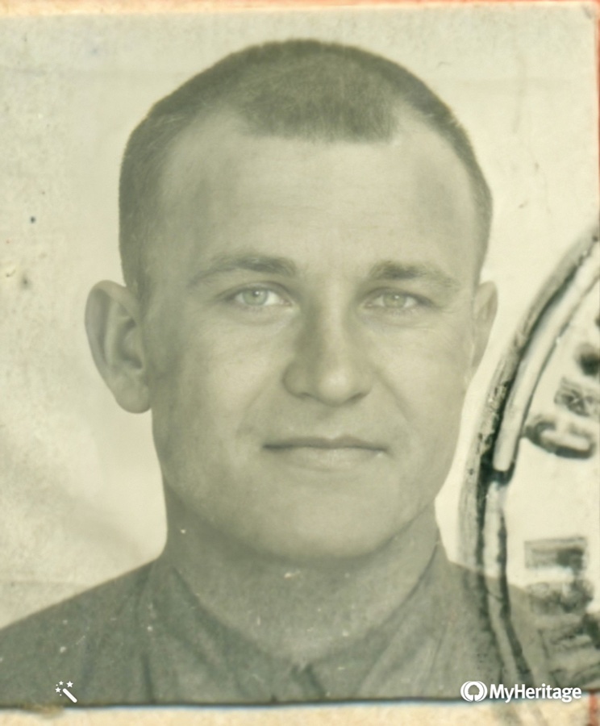
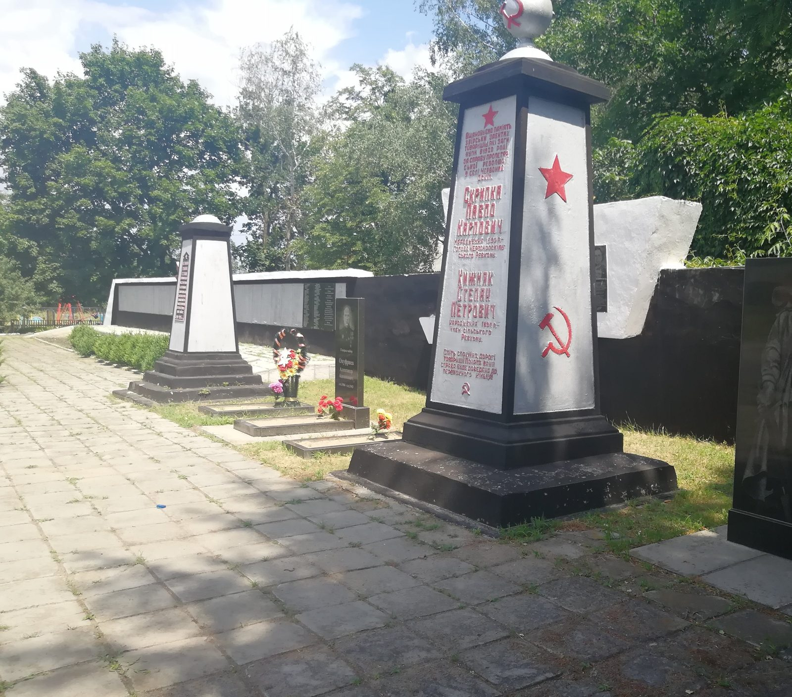
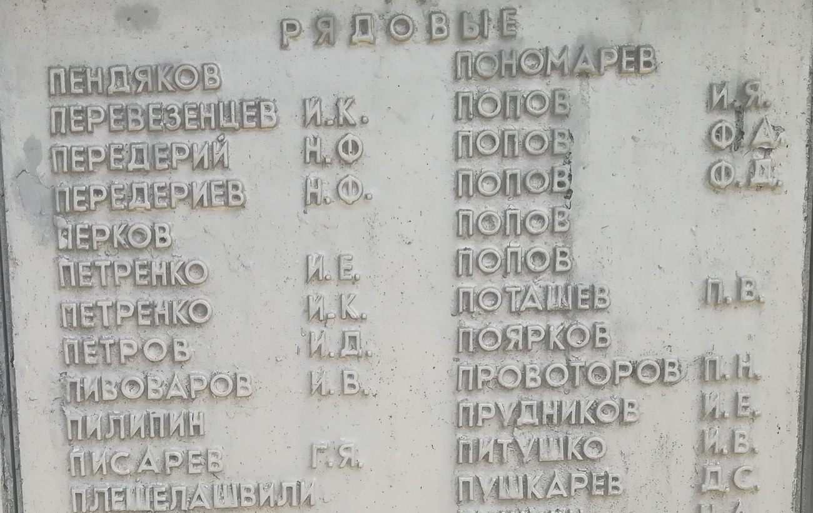

# Григорий Яковлевич Писарев (1919 – 1943)

{ align=right width="240" }

Григорий Яковлевич Писарев родился 22 января 1919 года в крестьянской семье в деревне Глазки Казинской волости Ржевского уезда Тверской губернии (позже — Оленинский район) [A1042]. Окончил школу в Оленинском районе, в 1940 году жил в посёлке Дятлово Нелидовского района. Был женат на Марии Васильевне Березовской, 12 марта 1942 года у них родился сын Валерий. В 1941 году его призвал Ржевский райвоенкомат. Красноармеец, шофёр 8-го моторизованного понтонно-мостового полка Юго-Западного фронта, в марте 1943 года вступил кандидатом в партию. 15 июля 1943 года погиб от разрыва немецкого артиллерийского снаряда у села Красный Оскол Харьковской области; ему было 24 года. Похоронен в лесу у села, затем перезахоронен в братскую могилу в центре Красного Оскола; его имя есть на мемориальной доске [A1038][A1040][A1041].

*Фотография — с отчётной карточки кандидата в члены ВКП(б), март 1943 г. [A1041]; улучшена сервисом MyHeritage.*

## Краткие сведения

- **Родился:** 22 января 1919 г., [дер. Глазки](PLC1001) Казинской волости Ржевского уезда Тверской губернии (позже — Оленинский район) [A1042][A1038].
- **Родители:** отец — [Яков Иванов (Иванович) Писарев](P1078), хлебопашец [A1042]; мать — Ксения Писарева, в записи о рождении «Ксения Петрова» (Петровна) [A1042], в донесении 1943 г. — Ксения Антоновна; в 1943 г. жила в пос. Дятлово Нелидовского района Калининской области [A1038].
- **Жена:** Мария Васильевна Березовская («Маруся») [L1000][L1002].
- **Сын:** Валерий («Валерик»), р. 12 марта 1942 г. (свидетельство о рождении, документ у составителя) [L1000].
- **Призван:** в 1941 г. Ржевским райвоенкоматом Калининской области [A1038][B1003].
- **Служба:** красноармеец, шофёр 8-го моторизованного понтонно-мостового полка (8 МПМП); в 1942 г. — полевая почта 28, в/ч 289 [A1038][L1002].
- **Партийность:** кандидат в члены ВКП(б) с марта 1943 г. [A1041].
- **Погиб:** 15 июля 1943 г., «убит при взрыве арт. снаряда противника» [A1038].
- **Похоронен:** сначала в лесу юго-западнее с. Красный Оскол Изюмского района Харьковской области; затем перезахоронен в братскую могилу в центре села (сейчас — с. Оскол, Украина), имя — на мемориальной доске [A1038][A1040].

## Детство и юность (1919–1941)

Рождение Григория записано в книге записей рождений по Казинской волости Ржевского уезда. Такие гражданские книги после декрета 1917 года заменили церковные метрические книги. Запись № 12: «22 Янв. 1919. Григорий Яковлев Писарев. Отец Яков Иванов Писарев. Мат. Ксения Петрова Писарева. Хлебоп. дер. Глазки Козинской в.» [A1042]. «Хлебоп.» — хлебопашец, то есть родители были крестьянами. Свидетелем записан «гр. д. Луки Мирон Питушков», а в графе подписей родителей стоят имена других людей — «гр. д. Глазки Григорий Иванов … Силой Гаврилов»; по-видимому, родители были неграмотны [A1042]. Помета у номера записи «выд. 16.02.36 г.» показывает, что 16 февраля 1936 года по этой записи выдали документ [A1042].

В документах военного времени место рождения записано по новому административному делению: «1919 год, д. Глазки Оленинский район Калининская обл.» [A1038]; в Книге памяти — «род. 1919, Оленинский район» [B1004]. По заметкам составителя, деревня Глазки стояла у деревни Мясница; их разделяет речка Мясничка.

Отчество матери в документах расходится: в записи о рождении 1919 года она «Ксения Петрова», то есть Петровна [A1042], а в донесении о потерях 1943 года и в списке 1989 года — Ксения Антоновна [A1038][A1039] (см. «Замечания о документах»).

Самый ранний документ о нём — фотография, которую он подписал вместе с другом: «На память снявши два това[рища] Петр Никитьевич Орлов 13 лет дер. Мясница Григорий Яковлевич Писарев 13 лет дер. Глазков. На вечную и до[л]гую Память» [F1002]. По возрасту в надписи снимок датируют примерно 1932 годом.

В 1931–1934 годах Григорий учился в Бобровской школе. Об этом говорит свидетельство об окончании школы, скан которого есть у составителя. Адрес школы на бланке — «п/о Оленино Западной обл.»: Оленинский район тогда входил в Западную область с центром в Смоленске, а с 1935 года — в Калининскую область. Свидетельство выдано 7 сентября 1934 года: «Писарев Григорий, родившийся в 1919 году, поступил в школу в 1931 году, окончил ее в 1934 году». По всем двенадцати предметам у него отметка «удовлетвор.». В графе «общественная работа» записано: «участвовал в провед. с/хоз. полит. кампаний» — то есть в сельскохозяйственных политических кампаниях (сев, хлебозаготовки и т. п.).

В 1940 году Григорий жил, по-видимому, в посёлке Дятлово Нелидовского района: там он сфотографировался с товарищем. На обороте снимка написано: «Писарев Григорий Яковлевич Кузмин Сергей Пименович фотографировались в пос. Дятлово 1940 году» [F1003]. На снимке — молодой человек в кепке и очках, в пиджаке, со значком на лацкане. В Дятлове в 1943 году жила и его мать [A1038].

Когда Григорий женился на Марии Васильевне Березовской, в документах не сказано. Сын Валерий родился 12 марта 1942 года — эта дата указана в его свидетельстве о рождении, которое хранится у составителя. Григорий в это время уже был на фронте. В июне 1942 года он пишет о «маленьком сынке Валерике» [L1000].

## На фронте (1941–1943)

По Книгам памяти Тверской области, Григория призвали в 1941 году [B1003][B1004]. В донесении о потерях записано, что призвал его «Ржевским РВК Калининской области» [A1038]. Осенью 1941 года Калининская область стала фронтовой: Оленино было занято немцами с октября 1941 года до 4 марта 1943 года, Нелидово освобождено в январе 1942 года.

### Письма жене

От 1942 года сохранились три письма Григория жене. Жена с сыном жили тогда в Омской области, в деревне Филиново Крутинского района: туда адресована открытка от 5 ноября 1942 года — «Омская область п/о Паново д. Филиново Крутинского р-на Березовской Марии Васильевны» [L1002]. В письмах он передаёт приветы «дедушке, бабушке», Моне, Зине, Нилу Федоровичу; кто они, из писем не ясно [L1000][L1001][L1002].

21 июня 1942 года он писал: «Я до настоящего дня жив и здоров и здоровье пока отличное. За успешное проведение боевых действий нашу часть направляют на отдых в Горьковскую область примерно на 2 месяца» [L1000]. В том же письме он беспокоится о родных, оставшихся дома: «Я пока ничего не слышу, что мною писано в Оленино и Нелидово». Ответа не было: Оленино тогда ещё оставалось под оккупацией. Главная просьба письма — сохранить его гармонь: «Если будешь чего продавать, то прошу продай хоть до последней рубашки, но оставь мою гармошку, по которой я очень и очень скучаю. Мне бы сейчас ничего не надо, только бы сыграть, и война бы нипочем». Письмо заканчивается словами: «Может Маруся, встретится тот день, когда мы разобьем немецкую свору и встретимся с тобою» [L1000].

Письмо от 10 сентября 1942 года, написанное карандашом, читается с трудом. Григорий объясняет жене, почему не может назвать, где стоит: «это военная тайна, где стоит какая часть. и это запрещают писать». И добавляет: «за твое письмо вызывали и […] что я написал где мы стоим». И о том, чего ждать: «Ведь ты еще не понимаешь и не представляешь, что такое война и как можно пережить такие кровопролитные бои, которые мы прошли, и еще тяжелее бои у нас впереди… Ведь я еще молодой и здоровый, так что я всегда в первых рядах… Пуля не знает, что у меня где-то есть ты и сын, она косит всех подряд» [L1001]. Он описывает свой быт: «хлеба я получаю 650 грамм и не суп а супишка и сплю на отдыхе на травке под шинелью, винтовка под головой». Винтовку он «таскает второй год», то есть служил с 1941 года. Он снова просит о гармони: «продай лучше последнее пальто, но гармошку сохрани» [L1001].

Последнее письмо — почтовая карточка от 5 ноября 1942 года. Адрес отправителя: «полевая почта 28. в. часть 289. Писареву Г. Я.» Григорий просит прислать к зиме носки и перчатки: «Посылки принимают до 5 кг». И жалуется, что писем давно нет: «я посылаю через гражданскую почту, наверное не доходит. Пока все остаюсь жив и здоров. Досвидание, с приветом к вам всем муж Гриша» [L1002].

### Понтонно-мостовой полк

В 1943 году Григорий служил шофёром в 8-м моторизованном понтонно-мостовом полку [A1038]. Понтонно-мостовые полки относились к инженерным войскам. Они возили на машинах понтонный парк — плавучие опоры и пролёты — и наводили переправы через реки, по которым шли войска и техника. Шофёры таких полков подвозили понтоны к реке, нередко под огнём противника. По заметкам составителя, 8-й МПМП входил в состав Юго-Западного фронта как часть фронтового подчинения с 1 апреля по 30 сентября 1943 года. С 1 января по 31 марта и после 1 октября 1943 года полк значился как 8-й тяжёлый понтонно-мостовой полк.

В марте 1943 года Григорий вступил кандидатом в члены партии. Сохранилась отчётная карточка: «Писарев Григорий Яковлевич. 1919. Время вступления в кандидаты: март 1943 г. Наименование организации, выдавшей кандидатскую карточку: Политотдел Спецчастей Юго-Зап. Фронта». Карточка выдана 29 марта 1943 года, на ней его подпись и фотография [A1041]. Среди имеющихся материалов это единственный снимок Григория в военной форме.

## Гибель (15 июля 1943)

Летом 1943 года Юго-Западный фронт стоял по реке Северский Донец у Изюма. 17–27 июля 1943 года он вёл Изюм-Барвенковскую наступательную операцию с форсированием Донца; понтонные части готовили к ней переправы. Участвовал ли 8-й МПМП именно в этих событиях, в имеющихся документах не сказано.

15 июля 1943 года, за два дня до начала наступления, у села Красный Оскол разорвался немецкий артиллерийский снаряд. Он убил шестерых бойцов полка. В именном списке безвозвратных потерь полка за 10–16 июля Григорий записан третьим: «ПИСАРЕВ Григорий Яковлевич, красноармеец, Шофер, Член ВКП/б/, 1919 год, д. Глазки Оленинский район Калининская обл., Ржевским РВК Калининской области, 15.7.43 г. Убит при взрыве арт. снаряда противника. Лес Ю-З с. Красный Оскол Харьковской обл. Мать — Писарева Ксения Антоновна, Калининская область пос. Дятлово, Нелидовский район» [A1038]. Вместе с ним погибли сержант Иван Арсентьевич Пьяных, старший сержант Иван Антонович Варченко, ефрейтор Иван Яковлевич Косенко, красноармеец Максим Григорьевич Кравченко и младший сержант Семён Захарович Груздов. Список подписали командир полка майор Коржов и начальник штаба капитан Смирнов 16 июля 1943 года [A1038].

Всех шестерых похоронили вместе. К донесению приложена нарисованная от руки схема: «Схема места погребения бойцов и мл. командиров 8-го МПМП погибших от разрыва артснаряда противника в лесу примыкающему с Юго-Запада к д. Красный Оскол 15.07.43 г. Погребены: … Кр-цы: 1 Писарев Г. Я., 2. Кравченко М. Г., 3. ефрейтор Косенко И. Я.» На схеме — село на реке Оскол и звёздочка в лесу к югу от дороги [A1038].

Донесение поступило в управление по учёту потерь 2 августа 1943 года, и 3 августа данные внесли в картотеку безвозвратных потерь [A1038]. На партийной карточке Григория кто-то дописал фиолетовыми чернилами: «убит». Его кандидатские документы, как сообщил архив РГАСПИ, «были погашены Главным политуправлением РККА 28.01.1944 г. в связи со смертью» [A1041].

### Братская могила в Красном Осколе

Позже Григория перезахоронили в братскую могилу в центре Красного Оскола, где он покоится и сейчас. В поимённом списке этой могилы (1991) он записан под № 536: «Рядовой. Писарев Г Григорий Яковлевич. 1919 г. 15 июля 1943 г. с. Кр. Оскол». В графе «откуда перезахоронен» стоит «с. Москалево» [A1040]. Совпадает ли это место с лесом из схемы 1943 года, по документам не ясно. Его имя есть на мемориальной плите у братской могилы (см. ниже).

**Красный Оскол** (с 2016 года — село Оскол) стоит на реке Оскол, у впадения в неё речки Бахтин, в Изюмском районе Харьковской области Украины. Его основали в 1599–1600 годах как крепость Царёв-Борисов: её построил по приказу царя Бориса Годунова воевода Богдан Бельский, чтобы защищать южную границу Московского государства от набегов крымских татар. В 1919 году Царёв-Борисов переименовали в Красный Оскол. Рядом с селом — плотина Оскольского водохранилища и Краснооскольская ГЭС. Село освободили от немцев 3 февраля 1943 года; с этого дня и ведёт отсчёт братская могила.

По учётной карточке 1991 года, это «Братская могила, Обелиск со звездой» в центре села, рядом с универмагом. Обелиск из железобетона высотой 2,27 м на кирпичном постаменте поставили в 1949 году. На нём надпись: «Вечная слава героям, павшим в боях с врагом и отдавшим свою жизнь за счастье и независимость нашего народа в Отечественной войне в 1941–1945 гг.» В могиле похоронены 1216 человек, из них известны по именам 793, неизвестны 423. Шефствовал над могилой колхоз «Красный Оскол» [A1040].

28 июня 2020 года эту братскую могилу нашёл и посетил внук Григория Яковлевича Павел П., автор сайта; он же сделал снимки [F1004]. Мемориал к тому времени был перестроен: вдоль дорожки тянется стена с плитами, на которых выбиты имена похороненных, перед ней стоят обелиски и гранитные стелы. На плите «Рядовые» есть строка «ПИСАРЕВ Г. Я.» [F1004].

*Мемориал у братской могилы, 28 июня 2020 г. Фото Павла П. [F1004]*

{ width="520" }

*«ПИСАРЕВ Г. Я.» на плите с именами рядовых, 28 июня 2020 г. Фото Павла П. [F1004]*

## Память

В 1993 году его сын Валерий Григорьевич запросил через Камчатский облвоенкомат Центральный архив Министерства обороны о судьбе отца. Ответ ЦАМО от 17 марта 1993 года, скан которого есть у составителя, повторяет данные донесения 1943 года: «шофер 8 понтонно-мостового полка рядовой Писарев Григорий Яковлевич, 1919 г. р., уроженец Калининской области, Оленинского района, д. Глазки, призван в СА Ржевским РВК Калининской области, погиб 15.07.43 г. Похоронен: лес юго-зап. с. Красный Оскол, Харьковской обл.» Основание: «ЦАМО, донесение № 26392 1943 г.».

В 1989 году Кулдигский райвоенкомат Латвийской ССР включил Григория в список погибших воинов для Книги памяти. Родственницей в нём записана «Антонова Ксения Антоновна, г. Салдус» [A1039]. Имя и отчество совпадают с именем и отчеством его матери, фамилия — нет (см. «Замечания о документах»).

Григорий Яковлевич есть в двух томах Книги памяти Тверской области: в т. 4 (Ржевский район, по месту призыва) [B1003] и в т. 8 (Нелидовский район) [B1004]. Его карточки, донесение о потерях и документы о захоронении опубликованы на портале «Память народа» [A1038][A1039][A1040].

## Семья

- **Отец** — Яков Иванович Писарев, хлебопашец, дер. Глазки (1919) [A1042].
- **Мать** — Ксения Писарева: в записи о рождении 1919 г. — «Ксения Петрова» (Петровна) [A1042], в донесении 1943 г. — Ксения Антоновна; в 1943 г. жила в пос. Дятлово Нелидовского района Калининской области [A1038]. Возможно, она же — «Антонова Ксения Антоновна» из г. Салдус (Латвия) в списке 1989 г. [A1039].
- **Жена** — Мария Васильевна Березовская; в 1942 г. жила с сыном в д. Филиново Крутинского района Омской области [L1000][L1002]. По заметкам составителя, после войны она с сыном переехала в пос. Дятлово, около 1946–1947 гг. вышла замуж за Ивана Павловича Наумова; у них родился сын Станислав.
- **Сын** — Валерий Григорьевич Писарев, р. 12 марта 1942 г. (свидетельство о рождении, документ у составителя) [L1000]. По заметкам составителя, окончил 9 классов в Нелидове в 1958 г.; в марте 1959 г. семья Наумовых-Писаревых переселилась в Хабаровский край (Еврейская автономная область, Биробиджанский совхоз), позже — в Тюмень. Работал трактористом. В 1993 г. запрашивал ЦАМО о судьбе отца.

## Хронология

| Дата | Событие | Место | Источник |
|---|---|---|---|
| 22.01.1919 | Рождение (запись № 12 в книге записей рождений) | дер. Глазки, Казинская вол., Ржевский у. | [A1042] |
| ок. 1932 | Фото с товарищем Петр. Никит. Орловым («13 лет») | дер. Мясница — дер. Глазки | [F1002] |
| 1931–1934 | Учёба в Бобровской школе | п/о Оленино, Западная обл. | свидетельство об окончании школы (скан у составителя) |
| 07.09.1934 | Выдано свидетельство об окончании школы | — | свидетельство (скан у составителя) |
| 16.02.1936 | По записи о рождении выдан документ (помета «выд. 16.02.36 г.») | — | [A1042] |
| 1940 | Фото с Серг. Пим. Кузьминым | пос. Дятлово, Нелидовский р-н | [F1003] |
| 1941 | Призван Ржевским РВК | Калининская обл. | [A1038][B1003][B1004] |
| 12.03.1942 | Рождение сына Валерия | — | свидетельство о рождении (у составителя); [L1000] |
| 21.06.1942 | Письмо жене: часть отводят на отдых в Горьковскую обл. | фронт | [L1000] |
| 10.09.1942 | Письмо жене | фронт | [L1001] |
| 05.11.1942 | Открытка жене; полевая почта 28, в/ч 289 | фронт → д. Филиново, Омская обл. | [L1002] |
| 03.1943 | Вступил кандидатом в члены ВКП(б); карточка выдана 29.03.1943 | Юго-Западный фронт | [A1041] |
| 15.07.1943 | Погиб от разрыва артиллерийского снаряда | у с. Красный Оскол, Харьковская обл. | [A1038] |
| 15.07.1943 | Похоронен в лесу юго-западнее Красного Оскола | Изюмский р-н | [A1038] |
| 16.07.1943 | Подписан именной список потерь 8 МПМП | — | [A1038] |
| 03.08.1943 | Внесён в картотеку безвозвратных потерь | — | [A1038] |
| 28.01.1944 | Кандидатские документы погашены Главным политуправлением РККА «в связи со смертью» | — | [A1041] |
| 1989 | Включён в список погибших Кулдигского райвоенкомата | Латвийская ССР | [A1039] |
| 13.07.1991 | В поимённом списке братской могилы, № 536 | с. Красный Оскол | [A1040] |
| 1993 | Статья в Книге памяти Тверской обл., т. 4 | Тверь | [B1003] |
| 17.03.1993 | Ответ ЦАМО на запрос сына | Подольск | справка ЦАМО (скан у составителя) |
| 1995 | Статья в Книге памяти Тверской обл., т. 8 | Тверь | [B1004] |
| 28.06.2020 | Внук Павел П. нашёл и посетил братскую могилу; имя Григ. Як. Писарева — на мемориальной плите | с. Оскол (бывш. Красный Оскол) | [F1004] |

## Замечания о документах

- **Год рождения.** По записи о рождении — 22 января 1919 г. [A1042]; 1919 стоит и во всех остальных документах [A1038][A1039][A1040][A1041][B1004], кроме т. 4 Книги памяти, где напечатано «род. 1910» [B1003] — опечатка.
- **Отчество матери.** В записи о рождении 1919 г. мать названа «Ксения Петрова» (Петровна) [A1042], в донесении о потерях 1943 г. — «Писарева Ксения Антоновна» [A1038], в списке 1989 г. — «Антонова Ксения Антоновна» [A1039]. Кто ошибся — писарь волостного отдела в 1919 г. или полковой писарь в 1943 г., — по документам не установить.
- **Партийность.** В донесении о потерях — «Член ВКП/б/», а по партийной карточке в марте 1943 г. он стал кандидатом [A1038][A1041]. Был ли он к июлю принят в члены партии, неизвестно; скорее всего, писарь полка не различал члена и кандидата.
- **Мать в 1989 г.** В латвийском списке 1989 г. родственница названа «Антонова Ксения Антоновна, г. Салдус, ул. Скрундас-39» [A1039]. Повторный брак матери, ошибка составителя списка или другая родственница — по документам не установить.
- **Место погребения.** В 1943 г. похоронен в лесу юго-западнее Красного Оскола [A1038]. Позже перезахоронен в братскую могилу в центре села (список 1991 г. [A1040]; имя на мемориальной плите — фото 2020 г. [F1004]). Перезахоронение подтверждено. Неясно только, почему в графе «откуда перезахоронен» стоит «с. Москалево», а не лес у Красного Оскола.
- **Письма.** Письмо от 10 сентября 1942 г. сохранилось не полностью (есть только лист «стр. 1») и читается с трудом; имя «Моня» в письмах прочитано неуверенно (возможно, «Маня») [L1001][L1002].
- **Документы без публикации на сайте.** Свидетельство об окончании школы (1934) и ответ ЦАМО (1993) пока не опубликованы. Их сканы есть у составителя.
- **Архивные шифры.** У отчётной карточки РГАСПИ и у карточки захоронения 1991 г. полный архивный шифр неизвестен [A1040][A1041].

## Исследовательские заметки

- **Предположение (не подтверждено документами).** По заметкам составителя, у Ксении Антоновны могла быть сестра — Вера Антоновна Писарева. В электронной Книге памяти Тверской области есть запись: «ПИСАРЕВА Вера Антоновна. род. 1918, дер. Васильки. Призвана в 1941. Старшина. Пропала без вести, март 1942». В ОБД «Мемориал», по тем же заметкам, есть справка 1948 г.: Писарева Вера Антоновна, 1921 г. р., уроженка дер. Глазки Оленинского района, санинструктор эвакогоспиталя в Звенигороде, призвана Москвой 22 июля 1941 г., пропала без вести в декабре 1941 г.; разыскивал её отец — Писарев Антон Иванович, дер. Глазки. Если Вера — сестра Ксении Антоновны, то отец Ксении — Антон Иванович Писарев, и девичья фамилия матери Григория тоже Писарева. Но в записи о рождении Григория 1919 г. мать названа «Ксения Петрова» [A1042], что этому предположению противоречит. Писаревы из Глазок могли быть и родственниками по линии отца: по метрическим книгам в Глазках жила семья Илариона Иванова Писарева, по-видимому брата Якова (гипотеза — на странице [P1078]). Ссылки на эти записи нужно найти заново и проверить.
- **Предположение (не подтверждено документами).** «Дедушка, бабушка», Моня, Зина и маленькая Галя, которым Григорий передаёт приветы, — по-видимому, родные жены в Омской области, у которых она жила с сыном.
- **Для поиска:** уроженцы д. Глазки в Книге памяти — Писарев Николай Илларионович («род. 1822» — опечатка в годе; пропал без вести в 1941 г.) — возможный родственник; журнал боевых действий 8-го МПМП за июль 1943 г.; районная газета «Радянське життя» от 12 февраля и 12 сентября 1958 г. о братской могиле [A1040].

## Источники

- [A1042] — запись о рождении в книге записей рождений по Казинской волости Ржевского уезда, 22 января 1919 г. (ГАТО, ф. Р-312, оп. 1, д. 204, л. 85)
- [A1038] — донесение о безвозвратных потерях 8-го МПМП, 16 июля 1943 г., со схемой места погребения (ЦАМО, ф. 58, оп. 18001, д. 304)
- [A1039] — список погибших воинов Кулдигского райвоенкомата Латвийской ССР, 1989 г. (ЦАМО, ф. 58, оп. А-71497, д. 4)
- [A1040] — учётная карточка братской могилы в с. Красный Оскол и поимённый список, 1991 г.
- [A1041] — отчётная карточка на кандидатскую карточку ВКП(б), 29 марта 1943 г. (РГАСПИ)
- [B1003] — Книга памяти. Тверская область. Т. 4, 1993, с. 520
- [B1004] — Книга памяти. Тверская область. Т. 8, 1995, с. 407
- [L1000] — письмо жене, 21 июня 1942 г.
- [L1001] — письмо жене, 10 сентября 1942 г.
- [L1002] — почтовая карточка жене, 5 ноября 1942 г.
- [F1002] — фотография с Петр. Никит. Орловым, ок. 1932 г.
- [F1003] — фотография с Серг. Пим. Кузьминым, пос. Дятлово, 1940 г.
- [F1004] — братская могила в с. Оскол и плита с именем Григ. Як. Писарева, фото Павла П., 28 июня 2020 г.

## Связанные персоны

- отец — [P1078]
