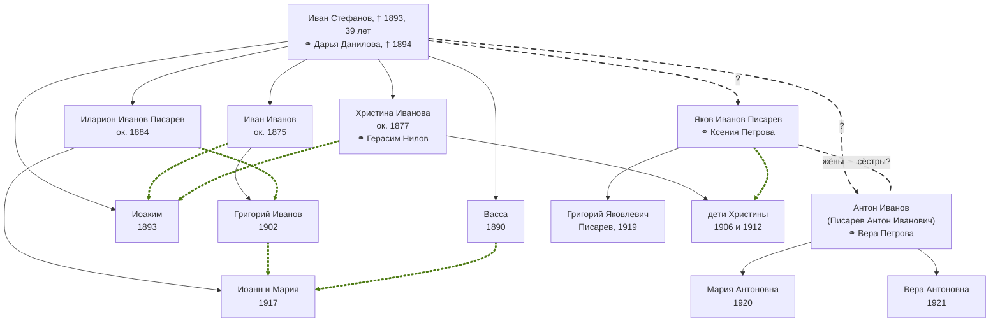

# Яков Иванов Писарев (? – ?)

Крестьянин-хлебопашец деревни [Глазки](PLC1001) (в метрических книгах — Глазков) Казинской волости Ржевского уезда **Тверской губернии**, отец [Григория Яковлевича Писарева](P1007). Достоверно о нём известно немного: в январе 1919 года у него и его жены Ксении Петровой родился сын Григорий [A1042], а в 1914 году он крестил сына своего односельчанина и полного тёзки — другого Якова Иванова [A1219]. Год его рождения, родители и дальнейшая судьба по документам пока не установлены.

## Краткие сведения

- **Сословие и фамилия:** крестьянин; в записи 1919 г. — «Хлебоп.», то есть хлебопашец [A1042]. Фамилия «Писарев» впервые записана при нём в 1919 г.; в церковных записях до 1917 г. он, как и другие крестьяне деревни, назван только по имени и отчеству — «Яков Иванов» [A1219].
- **Жил:** [дер. Глазки](PLC1001) Казинской (Козинской) волости Ржевского уезда Тверской губернии (позже — Оленинский район) [A1042].
- **Жена:** Ксения Петрова (Петровна) Писарева [A1042]; в документах сына 1943 г. — Ксения Антоновна [A1038].
- **Сын:** [P1007] — р. 22 января 1919 г. [A1042].
- **Восприемник:** в 1914 г. — у Александра, сына другого Якова Иванова из Глазков [A1219]; возможно, также в 1906 и 1912 гг. — у детей Христины Ивановой в д. Громовка [A1212][A1216] (см. ниже).

## Почему его трудно найти в документах: два Якова Ивановых

Главная сложность исследования — в Глазках в одно и то же время жили **два Якова Ивановых**. Деревня была маленькой (в 1859 г. — 5 дворов [B1005]), но имена и отчества у крестьян повторялись часто, а фамилий в церковных книгах до революции обычно не писали. Поэтому запись «крестьянин деревни Глазков Яков Иванов» может относиться к любому из них.

Второй — [Яков Иванов Закревский](P1079), «солдатский сын», женатый с 1904 г. на Феодосии Михайловой; у них было не меньше девяти детей. Различать двух Яковов помогают имена жён: если в записи названа Феодосия Михайлова, это Закревский; если Ксения Петрова — Писарев. Подробное сравнение, все записи о Закревском и о его семье — на [его странице](P1079).

Самая наглядная запись — крещение 1914 года. Метрическая книга, рождение Александра:

> «Казинской волости деревни Глазковъ крестьянинъ Яковъ Ивановъ и законная жена его Ѳеодосія Михайлова… Той же волости и деревни крестьянинъ Яковъ Ивановъ и той же волости и деревни крестьянская жена Варвара Николаева» [A1219].

Отец ребёнка — Закревский (жена Феодосия Михайлова). Крёстный — тоже «Яков Иванов» из той же деревни, то есть другой человек; по всей видимости, это и есть Яков Писарев. Восприемников (крёстных) обычно выбирали из родных и близких соседей, так что два Якова, видимо, были хорошо знакомы.

Второе свидетельство того, что это разные люди, — две записи о рождении в одной и той же книге записей рождений Казинской волости в январе 1919 года: 15 января родилась Ксения, дочь «Якова Ивановича Закревского» и «Федосьи Михайловой Закревской», и её отец расписался в книге сам [A1224]; 22 января родился Григорий, сын «Якова Иванова Писарева» и «Ксении Петровой Писаревой», и за его родителей расписались другие люди [A1042].

## Рождение сына (1919)

После декрета 1917 года рождения стали записывать не в церковных метрических книгах, а в гражданских книгах при волостях. Книга записей рождений по Казинской волости, запись № 12: «22 Янв. 1919. Григорий Яковлев Писарев. Отец Яков Иванов Писарев. Мат. Ксения Петрова Писарева. Хлебоп. дер. Глазки Козинской в.» [A1042].

«Яков Иванов» — старая форма отчества, то есть Яков Иванович. В графе «Подписи родителей или лиц, заменяющих их личность» стоят имена «гр. д. Глазки Григорий Иванов» и «Силой Гаврилов» [A1042]: по-видимому, Яков и Ксения были неграмотны или не пришли в волостной отдел сами.

## Восприемник у Нилов из Громовки (1906, 1912)

Дважды «Яков Иванов» из Глазков крестил детей Герасима Нилова и Христины Ивановой из соседней деревни Громовки: Иакова в ноябре 1906 г. («Той же волости деревни Глазковъ крестьянинъ Яковъ Ивановъ») [A1212] и Иустину в сентябре 1912 г. («Той же волости деревни Глазковъ крестьянинъ Яковъ Ивановъ и той же волости и деревни крестьянская дѣвица Ѳеодора Иванова») [A1216]. Какой из двух Яковов здесь назван, записи не говорят. Христина Иванова — по-видимому, сестра Илариона Иванова Писарева (см. «Исследовательские заметки»), поэтому скорее всего крёстным был Яков Писарев; это предположение.

## Семья

- **Жена:** Ксения Петрова (Петровна), в документах 1943 г. — Ксения Антоновна; в 1919 г. жила в дер. Глазки, в 1943 г. — в пос. Дятлово Нелидовского района [A1042][A1038].
- **Сын:** [P1007] (22.01.1919 – 15.07.1943) [A1042][A1038].

Записи о браке Якова и Ксении и о других их детях в имеющихся материалах нет.

## Хронология

| Дата | Событие | Место | Источник |
|---|---|---|---|
| 18.11.1906 | Яков Иванов из Глазков — крёстный Иакова, сына Герасима Нилова (который из двух Яковов — неизвестно) | д. Громовка | [A1212] |
| 29.09.1912 | Яков Иванов из Глазков — крёстный Иустины, дочери Герасима Нилова (который из двух — неизвестно) | д. Громовка | [A1216] |
| 08.1914 | Крёстный Александра, сына другого Якова Иванова (Закревского) | д. Глазков | [A1219] |
| 22.01.1919 | Родился сын Григорий; отец — «Яков Иванов Писарев», хлебопашец | дер. Глазки | [A1042] |

## Замечания о документах

- **Не найдено:** запись о рождении Якова, запись о его браке с Ксенией Петровой, сведения о нём после 1919 г. В донесении о гибели сына в 1943 г. из родных названа только мать [A1038] — возможно, отца к тому времени уже не было в живых или он жил отдельно; документально это не установлено.
- **Отчество жены.** В 1919 г. — «Ксения Петрова», в 1943 г. — «Ксения Антоновна» [A1042][A1038] (подробнее — на странице [P1007]).
- Какие книги просмотрены (по сообщению составителя): метрические книги Покровской церкви погоста Язвицы Ржевского уезда — 1888–1897 гг. (ГАТО, ф. 160, оп. 15, д. 902), 1898–1911 гг. (ф. 160, оп. 15, д. 903), 1912–1918 гг. (ф. 160, оп. 15-3, д. 3260); книги записей рождений по Казинской волости Ржевского уезда за 1919 г. (ГАТО, ф. Р-312, оп. 1, д. 204 и оп. 2, д. 140). Метрические книги Успенской церкви соседнего с. Бобровка за 1903–1910 гг. (ГАТО, ф. 160, оп. 15, д. 1025) — там найдена запись [A1214]. Записей ранее 1888 г. и позже 1919 г. пока не смотрели.

## Исследовательские заметки

**Предположение (не подтверждено документами).** Яков Иванов Писарев — сын крестьянина Ивана Стефанова из Глазков и брат Илариона Иванова Писарева. Прямой записи, где Яков назван сыном Ивана Стефанова, нет. Вывод построен на совпадении фамилии, отчества и деревни, а также на том, кого эта семья выбирала в крёстные и поручители.

### Схема предполагаемого родства

Сплошные линии — родство по метрическим записям, длинный пунктир со знаком «?» — предположение, жирные зелёные точки — от крёстного (крёстной) к крестнику, ⚭ — брак. Схему можно открыть на весь экран кнопкой над ней.

Если гипотеза верна, Григорий Яковлевич и Вера Антоновна — двоюродные брат и сестра и по отцу, и по матери, а Иларион Иванов — дядя Григория.

### Семья Ивана Стефанова из Глазков

По метрическим книгам видна одна семья, дети которой постоянно появляются в записях друг друга:

- **Иван Стефанов**, крестьянин деревни Глазков, умер 1 февраля 1893 г. в 39 лет «отъ сыпнаго тифа» [A1200].
- **Дарья Данилова**, его жена. 8 сентября 1893 г., уже вдовой, родила сына Иоакима [A1201]; сама умерла 5 октября 1894 г. «крестьянская вдова… 41» [A1203].
- Их дети (по записям):
    - **Иван Иванов**, «крестьянскій сынъ», 19 лет, женился 17 февраля 1894 г. на Дарье Семеновой из д. Курчевских [A1202]; крёстный младшего брата Иоакима [A1201].
    - **Христина Иванова**, «крестьянская дочь», 20 лет, вышла 20 января 1897 г. за Герасима Нилова из д. Громовка [A1204]; крёстная Иоакима [A1201].
    - **Иларион Иванов**, «крестьянскій сынъ», 19 лет, женился 27 января 1903 г. на Прасковье Евграфовой из д. Глиновка; поручитель жениха — Герасим Нилов, муж Христины [A1207]. Крёстный своего племянника Григория, сына Ивана Иванова (1902) [A1206].
    - **Васса**, родилась 13 августа 1890 г. «Деревни Глазковъ крестьянинъ Иванъ Стефановъ и законная жена его Дарья Данилова» [A1199]; 26 января 1911 г., 20 лет, вышла за Андрея Васильева из д. Прудёнки; поручитель невесты — снова Герасим Нилов [A1215].
    - **Иоаким**, родился 8 сентября 1893 г. [A1201].

**Фамилия Писарев в этой семье.** В ноябре 1917 г. на свадьбе Климента Герасимова из Громовки (по-видимому, сына Христины) поручителем был записан «Казинской волости дер. Глазковъ солдатъ Иларіонъ Ивановъ Писаревъ» [A1223]. Это единственная из имеющихся церковных записей, где фамилия Писарев написана при самом событии. В записи о рождении двойни Илариона, Иоанна и Марии (июль 1917 г.), фамилия «Писаревы» вписана позже, по решению суда, а крёстной записана «деревни Прудёнки солдатская жена Васса Иванова» — сестра Илариона [A1221].

**Связь с Яковом:**

- Яков Писарев — тоже «Иванов» из Глазков, и фамилия у него та же, что у Илариона [A1042][A1223].
- «Яков Иванов» из Глазков дважды крестил детей Христины Ивановой (1906, 1912) [A1212][A1216] — так обычно выбирали близких родственников.
- **Григорий Иванов, расписавшийся за родителей Григ. Як. Писарева в 1919 г.** [A1042], — по-видимому, тот же «гражданин Григорий Иванов» из Глазков, что в 1917 г. крестил двойню Илариона [A1221]. Вероятнее всего, это Григорий, сын Ивана Иванова, р. 1 марта 1902 г. [A1206]: в 1919 г. ему было 17 лет, то есть он был племянником Якова, молодым и, возможно, грамотным.
- Если Яков — сын Ивана Стефанова, он родился не позже начала 1893 г. (отец умер в феврале 1893 г.). Среди записей о детях этой семьи за 1888–1893 гг. рождения Якова нет — возможно, он родился до 1888 г.

**Другие Писаревы из Глазок** в Книге памяти и ОБД «Мемориал» (по заметкам составителя): Николай Илларионович Писарев — по отчеству, вероятно, сын Илариона Иванова; Антон Иванович Писарев (жил в Глазках в 1948 г.) — по отчеству мог быть ещё одним братом. Это тоже не подтверждено.

### Антон Иванов — брат Якова?

**Предположение (не подтверждено документами).** Антон Иванов из Глазков — ещё один сын Ивана Стефанова, брат Якова и Илариона, а его жена Вера Петрова — родная сестра Ксении Петровой, жены Якова. Тогда два брата были женаты на двух сёстрах.

На чём это основано:

- 31 января 1920 года в Глазках родилась «Марія Антоновна»; родители — «Антонъ Ивановъ» и «Вера Петрова», земледельцы, «Козин. вол. д. Глазков» [A1259]. Это единственная запись по Глазкам в книге рождений волости за январь–апрель 1920 года.
- По отчеству и деревне Антон Иванов — тот же круг, что Яков Иванов и Иларион Иванов Писаревы [A1042][A1223]. В 1948 году в Глазках жил Писарев Антон Иванович: по донесению Оленинского райвоенкомата он разыскивал дочь — старшину, санинструктора Веру Антоновну Писареву, 1921 г. р., уроженку Глазок, пропавшую без вести в 1941 году [A1260]. По-видимому, это младшая сестра Марии, родившаяся через год.
- Жена Якова в 1919 году записана «Ксения Петрова» [A1042], жена Антона в 1920 году — «Вера Петрова» [A1259]: обе — дочери Петра. В 1912 году среди крёстных у Христины Ивановой, по-видимому сестры Якова, есть ещё «Ирина Петрова» [A1212] — возможно, третья сестра. Совпадение отчества само по себе ничего не доказывает: Петр — частое имя.
- Ксения в документах сына 1943 и 1989 годов — «Ксения Антоновна» [A1038][A1039]. Если Антон — брат Якова, то отчество «Антоновна» не значит, что Антон Иванович был её отцом: у ребёнка, рождённого в 1920 году, отец — ровесник Якова, а не человек поколения его тестя. Отчество в 1943 году могло перепутаться с семьёй Антона, жившей рядом. Ранее составитель предполагал, что Антон Иванович — отец Ксении, а Вера Антоновна — её сестра (см. [P1007]); запись 1920 года делает эту версию менее вероятной.

**Что хорошо бы узнать для проверки:**

1. **Запись о браке Антона Иванова и Веры Петровой** (по-видимому, 1915–1919 гг.): из какой деревни невеста, как зовут её отца, кто поручители. Если Вера и Ксения — сёстры, у них будет одна деревня и один отец Петр. Искать в метрических книгах Покровской церкви погоста Язвицы (ГАТО, ф. 160, оп. 15-3, д. 3260 — 1912–1918) и в книгах записей браков Козинской волости за 1918–1920 гг. (ГАТО, ф. Р-312).
2. **Запись о браке Якова Иванова и Ксении Петровой** (ок. 1915–1918 гг.) — те же книги. Это проверит и девичье отчество Ксении: Петровна или Антоновна.
3. **Рождение Веры Антоновны** (1921 г.) и других детей Антона Иванова — книги записей рождений Козинской волости за 1921–1925 гг. (ГАТО, ф. Р-312); там же видно, жила ли семья Антона по соседству с семьёй Якова.
4. **Рождение Антона, сына Ивана Стефанова** — метрические книги погоста Язвицы за 1875–1893 гг. (ф. 160, оп. 15, д. 902 и раньше): если Антон — брат Якова, он родился до февраля 1893 г., когда умер Иван Стефанов [A1200].
5. **Документы о Вере Антоновне Писаревой** — донесение 1948 г. найдено [A1260]; возраст Антона Ивановича там не указан. Может помочь извещение о пропаже без вести, выписанное в январе 1948 г. на имя отца (в семье или в военкомате), и личное дело или учётная карточка санинструктора эвакогоспиталя в Звенигороде (ЦАМО).
6. **Исповедные ведомости или подворные списки Глазков 1910-х гг.** (а также похозяйственные книги 1920–1930-х гг., если сохранились) — где братья записаны по дворам.
7. **Ксения Петровна, дочь Петра, в метриках соседних деревень** около 1895–1900 гг. — с сестрой Верой (и, возможно, Ириной).

**Что могло бы подтвердить или опровергнуть гипотезу:** метрические книги Покровской церкви погоста Язвицы за 1875–1887 гг. (рождение Якова и других детей Ивана Стефанова); исповедные ведомости, где семьи записаны по дворам; запись о браке Якова и Ксении Петровой (около 1915–1918 гг., возможно, в приходе невесты).

## Источники

- [A1042] — запись о рождении сына Григория, книга записей рождений по Казинской волости, 22 января 1919 г.
- [A1224] — запись о рождении Ксении Закревской, та же книга, 15 января 1919 г.
- [A1219] — крещение Александра, сына Якова Иванова Закревского, 1914 г.; крёстный — Яков Иванов
- [A1212], [A1216] — крещение детей Герасима Нилова и Христины Ивановой, 1906 и 1912 гг.
- [A1199], [A1200], [A1201], [A1202], [A1203], [A1204], [A1206], [A1207], [A1215], [A1221], [A1223] — записи о семье Ивана Стефанова (1890–1917)
- [A1259] — рождение Марии, дочери Антона Иванова и Веры Петровой, Глазки, 1920 г.
- [A1260] — донесение Оленинского райвоенкомата 1948 г.: Вера Антоновна Писарева, отец — Писарев Антон Иванович

## Связанные персоны

- сын — [P1007]
- полный тёзка из той же деревни — [P1079]
