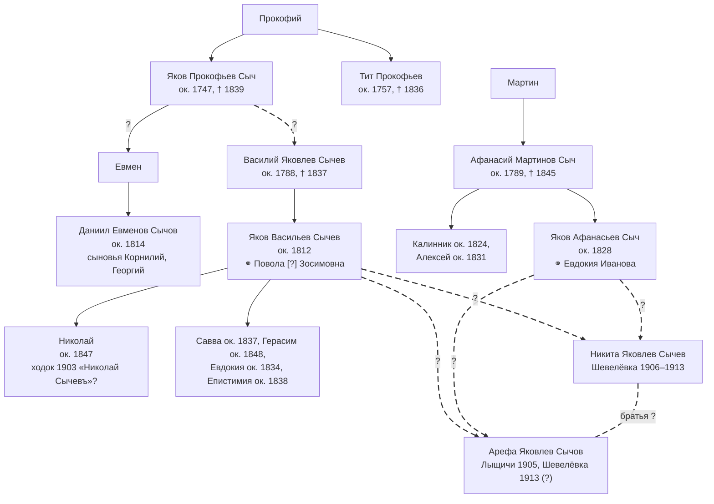
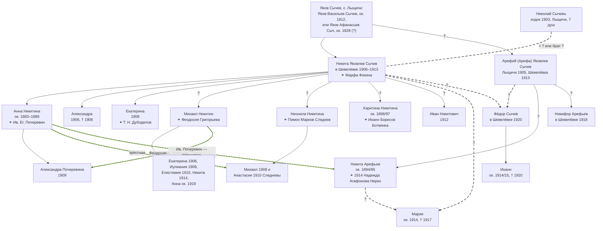

# Сычевы в Шевелёвке

В деревне [Шевелёвка](PLC1000) в 1906–1925 гг. жили несколько семей Сычевых. Одна из них — семья [Никиты Яковлева Сычева](P1008), отца [Анны Никитичны Почеревиной](P1003). Кем приходились ему остальные Сычевы, документы прямо не говорят. Здесь собраны все известные упоминания Сычевых в Шевелёвке, восстановлен состав семей и изложены предположения о родстве.

Основа разбора — три темы форума ВГД с расшифровками метрических книг Шкотовской церкви [W1009]. Составитель просмотрел их целиком и выписал все записи с фамилией Сычев (Сычёв, Сычева). К ним добавлены документы о Шевелёвке, которые уже есть на сайте: список ходоков 1903 г. [A1196], приговоры схода 1907 и 1913 гг. [A1018][A1029], список зачисленных на участок 1907 г. [A1019], запись о браке 1914 г. из Кролевецкой церкви [A1030] и запись 1925 г. [A1043].

Что важно помнить о расшифровках [W1009]:

- рождения расшифрованы только по 1910 г., браки и смерти — по 1922 г. Поэтому дети, родившиеся в 1911–1922 гг., видны только если умерли в младенчестве;
- в 1914 г. по крайней мере один житель Шевелёвки венчался не в Шкотове, а в Кролевецкой церкви [A1030]; книг Кролевецкой церкви в расшифровках нет;
- если записи нет в расшифровке, это ещё не значит, что её нет в подлинной метрической книге: расшифровщик мог её пропустить или неверно прочитать фамилию.

## Все упоминания

| Дата | Что записано | Как записан | Источник |
|---|---|---|---|
| 19.04.1903 | Ходок из с. [Лыщичи](PLC1020) Стародубского уезда зачислил землю под Шевелёвкой на 7 душ | «Николай Сычевъ» | [A1196] |
| 26.07.1906 | Смерть дочери Александры, 2 мес. | «Крест. д. Шевелёвка Никиты Иаковлева Сычёва, дочь Александра – 2 мес. (слабости)» | [A1044] |
| 04.10.1906 | Венчание Анны Никитиной с Ив. Ег. Почеревиным | «Крест. девица д. Шевелёвки Анна Никитина Сычева - 18л.» | [A1020] |
| 20.11.1906 | Рождение Екатерины | «Екатерина - крест. д. Шевелёвки Михаил Никитин Сычёв его жена Феодосия Григорьева. Крёстные: крест. д. Шевелёвки Иоанн Стефанов Скубовский и крест. жена той же дер. Мария Сергеева Максимова» | [W1009] |
| 11.02.1907 | Один из 14 домохозяев, образовавших сельское общество | «Никита Сычев» | [A1018] |
| 15.03.1907 | Список зачисленных на участок: № 3, 7 долей | «Никита Сычевъ» | [A1019] |
| 08.11.1908 | Рождение Иулиании | «Иулиания - Крест. д. Шевелёвки Михаил Никитин Сычёв его жена Феодосия Григорьева. Восприемники: крест. д. Шевелёвки Иоанн Стефанов Скубовский и той же дер. крест. жена Евдокия Спиридонова Киселькова» | [W1009] |
| 04.12.1908 | Рождение Екатерины | «Крест. д. Шевелёвки Никита Иаковлев Сычёв его жена Марфа Фокина» | [A1008] |
| 17.03.1909 | Крёстная Александры Почеревиной, дочери Анны | «крест. жена той же дер. Феодосия Григорьева Сычёва» | [A1025] |
| 04.08.1910 | Крёстная Евдокии, дочери Кирилла Назарьева Ляпунова | «крест. жена той же дер. Феодосия Григорьева Сычева» | [W1009] |
| 07.11.1910 | Рождение Епистимии | «Епистимия - крест. д. Шевелёвки Михаил Никитин Сычёв его жена Феодосия Григорьева. Крёстные: крест. д. Шевелёвки Иоанн Стефанов Скубовский и крест. жена той же дер. Евдокия Спиридонова Киселькова» | [W1009] |
| 20.10.1911 | Смерть Епистимии, 1 г. | «Крест. д. Шевелёвки Михаила Сычёва, дочь Епистимия– 1г. (дезинтерии)» | [W1009] |
| 23.09.1912 | Рождение Ивана Никитовича | по заметкам составителя | — |
| 13.01.1913 | Венчание Харитины Никитиной с Иоанном Борисовым Ботвинкой | «Крест. девица д. Шевелёвки Харитина Никитина Сычёва - 16л.» | [A1045] |
| 22.05.1913 | Трое Сычевых подписали (через других, за неграмотностью) приговор схода | «Арефий Сычев», «Ник. Сычев», «Михаил Сычев» | [A1029] |
| 26.01.1914 | Венчание Никиты Арефьева, 19 лет, с вдовой Надеждой Агафоновой Нерех из д. Суражевки (Кролевецкая церковь); поручитель по жениху — Иван Почеревин | «Крестьянинъ дер. Шевелевки … Никита Арефьевъ Сычевъ» | [A1030] |
| 12.11.1914 | Смерть Никиты, ½ г. | «Крест. д. Шевелёвки Михаила Сычёва, сын Никита – ½ г. (дизентерии)» | [W1009] |
| 09.10.1917 | Смерть Марии, 3 лет | «Гражд. д. Шевелёвки Никиты Сычёва, дочь Мария – 3г. (коклюша)» | [A1046] |
| 14/27.01.1918 | Поручитель по жениху на свадьбе Николая Никифорова Дарютина и Анны Петровны Кисельковой | «гражд. д. Шевелёвки … Никифор Арефиев Сычев» | [W1009] |
| 9/22.01.1920 | Смерть Анны, 1 г. (оспа) | «Гражд. д. Шевелёвки Михаила Сычёва, дочь Анна – 1г. (оспы)» | [W1009] |
| 8/21.02.1920 | Смерть Иоанна, 5 лет (оспа) | «Гражд. д. Шевелёвки Фёдора Сычёва, сын Иоанн – 5л. (оспы)» | [W1009] |
| 23.04.1925 | Брак Екатерины Никитичны с Тимофеем Никифоровичем Дубоделовым | «Сычева Екатерина Никитична» | [A1043] |
| 1938 | В похозяйственных книгах Шевелёвки значатся Сычевы (кто именно, неизвестно) | — | ответ архива (у составителя) |

Кроме того, урождённые Сычевы, вышедшие замуж в Шевелёвке, часто встречаются в записях крёстными: [Анна Никитина Почеревина](P1003) — у детей Следневых (1908, 1910) [A1022][A1027], Неонила Никитина Следнева — у детей Рослых (1907, 1909, 1910) и Кисельковых (1908, 1910) [W1009][A1026].

**Чего в расшифровках нет.** В записях Шкотовской церкви нет ни одного упоминания Арефия Сычева, нет свадеб Неонилы Никитиной, Михаила Никитина, Никифора Арефьева и Фёдора Сычева, нет записи о рождении Марии (около 1914 г.).

## Семьи

По записям видно не меньше трёх, а скорее четыре семьи Сычевых.

**1. Никита Яковлев Сычев** ([P1008]). Домохозяин с 1907 г., в 1907 г. за ним 7 долей [A1019]. Жена в 1908 г. — Марфа Фокина [A1008]. Дети, известные по документам: Анна (ок. 1883–1889), Александра (май – июль 1906), Екатерина (1908); по отчеству — Михаил, Неонила, Харитина; по заметкам составителя — Иван (1912). Возможно, Мария (ок. 1914 – 1917). Подробнее — на странице [P1008].

**2. Михаил Никитин Сычев.** Женат на Феодосии Григорьевой не позже начала 1906 г. Домохозяин 1913 г. [A1029]. Дети:

| Имя | Годы | Источник |
|---|---|---|
| Екатерина | 20.11.1906 – ? | [W1009] |
| Иулиания | 08.11.1908 – ? | [W1009] |
| Епистимия | 07.11.1910 – 20.10.1911 | [W1009] |
| Никита | ок. мая 1914 – 12.11.1914 | [W1009] |
| Анна | ок. 1919 – 9/22.01.1920 | [W1009] |

Крёстные всех троих дочерей, родившихся в 1906–1910 гг., — Иоанн Стефанов Скубовский, а у двух младших — ещё и Евдокия Спиридонова Киселькова [W1009]. Феодосия Григорьева сама крестила дочь Анны Почеревиной (1909) [A1025] — то есть свою племянницу по мужу. Сына, родившегося в 1914 г., Михаил назвал Никитой — по-видимому, в честь отца.

**3. Арефий Сычев и его сыновья.** В Шевелёвке Арефий известен только по подписи под приговором 1913 г.: он неграмотный домохозяин [A1029]. Отчество и возраст там не указаны. Но в июле 1905 г. в Лыщичах крёстным был «казенный крестьянин… Арефа Яковлев СЫЧОВ» [A1272] — по-видимому, он же (см. «[Сычевы в Лыщичах](#lyshchichi)»). Сыновья (по отчеству):

- Никита Арефьев, род. около 1894/95 г.; 26 января 1914 г. венчался в Кролевецкой церкви с вдовой Надеждой Агафоновой Нерех из д. Суражевки; брак расторгнут в 1928 г. во Владивостоке [A1030];
- Никифор Арефьев, в 1918 г. поручитель на свадьбе в Шевелёвке, значит, уже взрослый — родился не позже 1900 г. [W1009].

**4. Фёдор Сычев.** Известен по одной записи: в феврале 1920 г. умер его сын Иоанн, 5 лет, — значит, сын родился около 1914/15 г. [W1009]. Отчество Фёдора не указано. Домохозяином в 1913 г. он не был: под приговором подписались только трое Сычевых [A1029].

## Сычевы в Лыщичах {#lyshchichi}

Документов по Лыщичам сохранилось мало, и почти всё, что известно, собрано и расшифровано в теме форума ВГД «Лыщичи (село)» [W1010]. Составитель просмотрел её целиком. О Сычевых там нашлось вот что.

**1850 г., ревизская сказка** [A1271]. Двор № 144 — единственный, где фамилия записана «Сычев»:

- Василий Яковлев Сычев, 46 лет в 1834 г., умер в 1837 г.;
- его сын **Яков Васильев**, 38 лет (род. около 1812 г.), жена Повола [?] Зосимовна, 35 лет;
- их дети: Евдокия, 16 лет, **Епистимия**, 12 лет, Савва, 13 лет, **Николай**, 3 года (род. около 1847 г.), Герасим, 2 года.

Кроме того, в селе были **Сычи**: двор № 99 (Даниил Евменов, 36 лет, внук Якова Прокофьева Сыча, с сыновьями Корнилием и Георгием) и двор № 155 (сыновья умершего Афанасия Мартинова Сыча — Калинник, 26 лет, **Яков Афанасьев**, 22 года (род. около 1828 г.), с женой Евдокией Ивановой, 22 лет, детей пока нет, и Алексей, 19 лет). «Сыч» и «Сычов» — одна фамилия: тот же Даниил Евменов подписал сказку как «Даниил Евменов СЫЧОВ» [A1271]. Значит, Сычевы и Сычи Лыщичей — скорее всего, один род.

Там же записан двор № 145 — Следневы (Исак Николаев, умер в 1847 г., и его сыновья Емельян и Вавила) [A1271].

**1905 г., метрическая книга церкви с. Павличи** [A1272]. 26 июля крёстный у младенца из Лыщичей — «Того же села казенные крестьяне Арефа Яковлев СЫЧОВ и Ефросиния Васильева БЕЛОГУРОВА». Это первое и пока единственное упоминание Арефия с отчеством. **Он Яковлев — как и Никита.** И летом 1905 г. он ещё жил в Лыщичах.

**1914 и 1918 гг.** — в Лыщичах крестят детей Климент Исааков Сычев и Иуда Яковлев Сычев [W1010]. **1925 г.** — в списке избирателей Лыщичей больше пятнадцати Сычовых, по меньшей мере пять семей [W1010]: род остался в селе, уехала только часть.

**Чего нет.** В ревизской сказке 1858 г. (ГАБО, ф. 542, оп. 2, д. 545) записи **обрываются** после четвёртого двора; остальное, по-видимому, не сохранилось [W1010]. А именно в ней должны были быть дети Якова, родившиеся после 1850 г. Метрических книг Лыщичей 1850–1900 гг. в теме нет.

### Род Сычей в Лыщичах: схема до XVIII века {#rod-sychey}

**Предположение составителя (не подтверждено документами).** Ревизия 1850 г. указывает возраст на 1834 г. и год смерти, и по ней видно ещё два поколения назад [A1271]:

- **Яков Прокофьев Сыч** — 87 лет в 1834 г. (род. около 1747 г.), умер в 1839 г.; его брат **Тит Прокофьев** — род. около 1757 г., умер в 1836 г.; их отец — **Прокофий**. Внук Якова — Даниил Евменов (род. около 1814 г.), тот самый, что подписался под сказкой «СЫЧОВ»; значит, у Якова был сын Евмен;
- **Василий Яковлев Сычев** — 46 лет в 1834 г. (род. около 1788 г.), умер в 1837 г.; его отец — какой-то **Яков**;
- **Афанасий Мартинов Сыч** — 45 лет в 1834 г. (род. около 1789 г.), умер в 1845 г.; его отец — **Мартин**.

Единственный Яков этого рода подходящего возраста — Яков Прокофьев (около 1747 г.): при рождении Василия ему было бы около 41 года. Если Василий — его сын, то Сычевы двора № 144 и Сычи двора № 99 — одна семья, и линия выглядит так: Прокофий → Яков Прокофьев → Василий Яковлев → Яков Васильев (около 1812 г.) → Никита и Арефа (?). Против: Василий записан отдельным двором, а не в доме Якова Прокофьева, и прямой записи, что он сын Якова Прокофьева, нет. Как с ними связан Мартин, отец Афанасия, неизвестно.

Обозначения — как на схеме выше. Схема укорочена: дети Никиты и Арефы на ней не показаны.

Отцом Никиты и Арефы мог быть либо Яков Васильев Сычев, либо Яков Афанасьев Сыч (см. «[Кто был Яков, отец Никиты и Арефы](#kto-byl-yakov)»). Подтвердить или опровергнуть эту линию могли бы документы XVIII в., названные в теме форума: ревизская сказка 1795 г. по Лыщичам (ЦГИАК Украины, ф. 1855, оп. 1, д. 12; на форуме расшифрованы казаки, их подсуседки, цыгане и крестьяне; от крестьянской части сохранилась «только первая 1/3», и Сычей в ней нет) и материалы Киево-Печерской лавры в ЦГИАК (ф. 128) — ревизские сказки 1782 и 1785 гг., исповедные росписи вотчинных церквей [W1010]. Есть ли в них Лыщичи и Сычи, не проверено.

## Предположения о родстве

Ни одно из этих предположений не подтверждено документами.

### Схема: все Сычевы — одна семья? {#skhema}

**Гипотеза составителя.** Все Сычевы Шевелёвки — потомки одного человека, Якова Сычева из села [Лыщичи](PLC1020). Его сын Никита Яковлев приехал первым, около 1903 г., с детьми, в том числе со взрослыми и женатыми. Брат Никиты, Арефий Яковлев, в 1905 г. ещё жил в Лыщичах [A1272] и приехал с сыновьями позже Никиты — по одному из вариантов, между июлем 1905 и мартом 1907 г. (см. «[Кто входил в 7 душ](#sem-dush)»). Фёдор — сын одного из братьев. Тогда в Шевелёвке жили три поколения одной семьи: братья Никита и Арефий, их дети, а также внуки Никиты.

Сплошные линии — родство по метрическим записям; сплошная линия со знаком «?» — родство по отчеству (Яков — отец Никиты Яковлева и Арефы Яковлева, Арефий — отец Никиты и Никифора Арефьевых, Никита — отец детей «Никитиных»), но записи о рождении нет; длинный пунктир со знаком «?» — предположение; жирные зелёные точки — от крёстной (поручителя) к крестнику (жениху), ⚭ — брак. Схему можно открыть на весь экран кнопкой над ней.

Если гипотеза верна, Анна Почеревина и Никита Арефьев — двоюродные брат и сестра, а поручителем на свадьбе Никиты в 1914 г. был муж его двоюродной сестры. Тогда же понятно, почему Сычевы Арефьевы приехали именно в Шевелёвку: там уже жила семья их дяди.

Что может опровергнуть гипотезу: если окажется, что «Арефа Яковлев Сычов» 1905 г. и шевелёвский Арефий 1913 г. — разные люди, или что у Никиты и Арефы разные отцы (в Лыщичах могло быть несколько Яковов Сычевых — см. ниже).

**Арефий — брат Никиты Яковлева (или другой близкий родственник).** Доводы:

- фамилия одна, а деревня маленькая: в 1913 г. в Шевелёвке было 36 домохозяев [A1029];
- в 1907 г. Арефия среди домохозяев нет: в обоих списках только один Сычев, Никита [A1018][A1019]. Это значит, что своего двора у Арефия тогда не было, но не обязательно, что его не было в деревне: он мог жить в хозяйстве Никиты (см. «[Кто входил в 7 душ](#sem-dush)»). Предположение составителя: Арефий мог переселиться вслед за братом, уже устроившимся на новом месте (документов об этом нет);
- в 1914 г. сын Арефия Никита взял в поручители [Ивана Почеревина](P1002) — зятя Никиты Яковлева [A1030];
- в 1918 г. другой сын Арефия, Никифор, был поручителем на свадьбе Анны Петровны Кисельковой. Кисельковы — тот же круг, что и семья Никиты Яковлева: Евдокия Спиридонова Киселькова крестила дочерей Михаила Никитина, Неонила Следнева — детей Кисельковых [W1009].

- **главный довод:** в 1905 г. в Лыщичах записан «Арефа Яковлев СЫЧОВ» [A1272]. Отчество то же, что у Никиты, фамилия та же, село то же — откуда, по-видимому, приехал и Никита [A1196]. Летом 1905 г. Арефа ещё в Лыщичах, а в 1907 г. своего двора в Шевелёвке у него нет — это сходится с тем, что он переселился позже Никиты. Из Лыщичей в Приморье ехали и позже: в 1908 г. в с. Широкое того же Побережного подрайона причислили несколько семей из Лыщичей (возраст в документе указан «на весну 1907 года»), в том числе Кондратия Захарьева Следнева [W1010].

Против: прямой записи, что Арефа из Лыщичей 1905 г. и Арефий из Шевелёвки 1913 г. — один человек, нет. И одного отчества мало: в Лыщичах в 1850 г. было по меньшей мере два Якова из этого рода (см. ниже), так что Никита и Арефа могут быть и двоюродными братьями.

**Кто был Яков, отец Никиты и Арефы.** По ревизии 1850 г. подходят двое [A1271]:

- **Яков Васильев Сычев**, род. около 1812 г. За него — фамилия записана именно «Сычев»; у него был сын **Николай**, род. около 1847 г., — тогда ходок 1903 г. «Николай Сычевъ» [A1196] мог быть не ошибкой писаря, а старшим братом Никиты, который ездил выбирать землю для семьи; у него была дочь **Епистимия** — редкое имя, которое в 1910 г. Михаил Никитин дал своей дочери [W1009]. Против — возраст: жене Якова в 1850 г. было 35, и Никита с Арефой должны были родиться в 1850-х гг., самое позднее около 1860 г. Это возможно (сыновья Арефы родились около 1894–1900 гг., когда ему было бы под сорок и за сорок), но впритык.
- **Яков Афанасьев Сыч**, род. около 1828 г., в 1850 г. — 22 года, женат, детей ещё нет. По возрасту подходит лучше: его дети родились бы в 1850–1870-х гг. Против — в 1850 г. он записан не «Сычевым», а «Сычом», и следов Николая и Епистимии в его семье нет.

Решить вопрос могла бы ревизская сказка 1858 г. (ГАБО, ф. 542, оп. 2, д. 545), где были бы сыновья обоих Яковов, родившиеся в 1850–1858 гг. Но записи в ней обрываются после четвёртого двора — по-видимому, остальные листы не сохранились [W1010].

**Фёдор — сын Никиты Яковлева или Арефия.** В 1913 г. Фёдор не был домохозяином, значит, жил в чужом хозяйстве — скорее всего, отцовском. Сыновей-Фёдоров у Михаила быть не могло (его старшей дочери в 1913 г. было 6 лет). Остаются два варианта:

- сын Никиты Яковлева — тогда он брат Анны Почеревиной. Его можно было бы учесть среди 7 долей Никиты в 1907 г. [A1019] (см. «[Кто входил в 7 душ](#sem-dush)»);
- сын Арефия — тогда он брат Никиты и Никифора Арефьевых.

Сын Иоанн родился около 1914/15 г., значит, Фёдор женился около 1913–1914 гг. Его свадьбы в книгах Шкотовской церкви нет; возможно, он, как Никита Арефьев, венчался в приходе невесты.

**Мария (1917) — дочь Никиты Яковлева или Никиты Арефьева.** Мария родилась около 1914 г. (в октябре 1917 г. ей 3 года) [A1046]. Подходят оба Никиты:

- Никита Яковлев: его сын Иван, по заметкам составителя, родился 23 сентября 1912 г.; следующий ребёнок около 1914 г. вполне возможен;
- Никита Арефьев: женился 26 января 1914 г. [A1030], и ребёнок мог родиться в конце 1914 г.

Решить вопрос может только запись о рождении Марии. По тем же соображениям Харитина Никитина (р. ок. 1896/97) — дочь Никиты Яковлева, а не Никиты Арефьева: тот сам родился около 1894/95 г.

### Кто входил в 7 душ Никиты Сычева {#sem-dush}

В 1903 г. ходок «Николай Сычевъ» зачислил землю на 7 душ [A1196], и в марте 1907 г. за Никитой числятся те же 7 долей [A1019]. Кто это, документы не говорят. Ответ зависит от того, на кого давали доли: только на мужчин или на всех членов семьи. Графа в списке называется «Число долей» [A1019].

#### Мужские души или все?

Что говорят соседи Никиты по списку 1907 г. [A1019]:

- **Василий Максимов — 1 доля.** Но он был женат (его жена Мария Сергеева — крёстная в ноябре 1906 г.), а 31 января 1907 г., за полтора месяца до списка, у него родился сын Николай [W1009]. Если бы считали всех, было бы не меньше трёх. С «мужскими душами» это сходится, если число записано на время зачисления, до рождения сына.
- **Егор Почеревин — 2 доли.** Сходится с мужчинами: сам Егор и пасынок Иван. Если считали всех, то это Егор и его жена Евдокия, а Иван, женатый с октября 1906 г., учтён где-то ещё.
- **Андрей Хотинец и Димитрий Корж — по 2 доли.** У обоих в 1906 г. умерли дочери [W1009]; к 1907 г. остались, по-видимому, муж с женой. Это сходится со «всеми душами».
- **Марк Следнев — «7», исправлено на «1», с пометкой «Остальные въ исключеніи».** Доли тех, кто так и не приехал, из списка исключали. У Никиты 7 долей оставлены без исправления. Значит, к марту 1907 г. все семеро, по-видимому, были в Шевелёвке.

**Как в Шевелёвке давали доли — прямое свидетельство.** В приговоре схода 22 мая 1913 г. крестьяне просят приписать к обществу Ивана Яковлевича Ковехова «на 4 доли» и пишут о нём [A1029]:

> …каковой проживает в д. Шевелевке с 1 марта 1913 г. с семьей 4 душ мужского и 2 душ женского пола.

В семье шесть человек, из них четверо мужчин, — и ровно 4 доли. Значит, в Шевелёвке доли давали на мужские души. В списке 1907 г. графа тоже называется «Число долей» [A1019], так что, по-видимому, и там счёт шёл по мужским душам. Общие правила наделения переселенцев после 1900 г. составитель по литературе не проверял.

**Что такое «доля».** В списке ходоков 1903 г. на поле написано «Дорофеевка 40 дол.» и «Кишмишева Падь 59 дол.», и эти числа точно равны сумме душ в соответствующих строках [A1196]. Значит, одна душа — одна доля, то есть один надел. Все 17 ходоков 1903 г. вместе зачислили 99 долей, из них 7 — «Николай Сычевъ».

#### Сколько людей жило в Шевелёвке в 1904–1913 гг.

У Тарасова и в справочнике 1912 г. есть сведения о населении Шевелёвки:

| Дата | Что известно | Источник |
|---|---|---|
| 1 января 1904 г. | 6 семей: 9 мужчин и 11 женщин (20 человек) | [B1002] |
| 1 января 1905 г. | «12 мужских душ и за ходоками числилось 69 долей» | [B1002] |
| 1 января 1906 г. | 9 усадеб; 19 «малых семей», 112 человек (в конце 1905 г. добавились сахалинцы, жившие, по Тарасову, «в домах местных крестьян») | [B1002] |
| 15 марта 1907 г. | 16 хозяйств, всего 42 доли; у Никиты Сычева — 7 | [A1019] |
| 19 марта 1907 г. | общество «Шевелевка» утверждено «на 111 душевых долей» | [B1002] |
| 1912 г. | 39 дворов: 91 мужчина и 111 женщин (202 человека) | [B1012] |
| 22 мая 1913 г. | 36 домохозяев | [A1029] |

Как это читать:

- **12 мужских душ и 69 долей (1905 г.) — два разных счёта.** 12 — мужчины, которые уже жили в деревне; 69 — доли, которые держали за ходоками для семей, ещё не приехавших. Почему долей 69, а не 99, как в списке ходоков, неясно: может быть, часть ходоков к тому времени отказалась, или счёт велся по другому списку. Сверить можно только по самому документу (РГИА ДВ, ф. 1, оп. 4, д. 2173, л. 98), которого у составителя нет.
- **42 доли в 1907 г. — не «все жители».** Ещё в начале 1906 г. в деревне было 112 человек, и к 1907 г. население вряд ли уменьшилось. Значит, 42 — это не все люди, а доли, на которые зачислена земля, то есть, по-видимому, мужские души. Это сходится и с 1912 г.: в 1907 г. на хозяйство приходится в среднем 42 : 16 ≈ 2,6 доли — почти как мужчин на двор в 1912 г. (91 : 39 ≈ 2,3), а всех жителей на двор в 1912 г. вдвое больше (202 : 39 ≈ 5,2).
- **Сычевы не могли приехать все сразу.** На 1 января 1904 г. в деревне было всего 9 мужчин на 6 семей. Если бы все 7 мужских душ Никиты уже были на месте, на остальные 5 семей пришлось бы 2 мужчины. Значит, в начале 1904 г. мужчин-Сычевых было не больше трёх-четырёх. На 1 января 1905 г. мужчин в деревне 12 — тоже немного. А в марте 1907 г. за Никитой 7 долей без исключений [A1019]. По первому варианту это значит, что часть мужчин-Сычевых приехала между 1905 и 1907 гг. — как раз тогда, когда, по-видимому, переселился Арефа (летом 1905 г. он ещё в Лыщичах [A1272]).
- **111 долей общества (1907 г.) и 42 доли по списку** — числа разные, хотя счёт в обоих — на доли. Предположение составителя: 111 — число долей, на которое рассчитан участок, а 42 — сколько из них было зачислено за переселенцами в марте 1907 г.; в документах на сайте это не объяснено. К 1912–1913 гг. дворов стало 36–39 [B1012][A1029].

#### Два варианта: кто входил в 7 душ

**Вариант 1: 7 мужских душ.** Тогда в 1903 г. у Сычевых было семеро мужчин. Известны только Никита и его сын Михаил, возможно, Фёдор; сын Иван родился позже, в 1912 г. Недостающими могли быть Арефа и его сыновья — Никита (род. около 1894/95 г.) и Никифор (род. не позже 1900 г.). Вместе с Фёдором это шесть; седьмым мог быть ещё один сын, а может быть, и сам ходок Николай. Тогда картина такая:

- в 1903 г. ходок зачислил землю на всю большую семью обоих братьев;
- Никита с семьёй приехал первым; летом 1905 г. Арефа ещё в Лыщичах [A1272];
- к марту 1907 г. Арефа с сыновьями уже в Шевелёвке, но своего двора у него нет — все 7 долей записаны за Никитой [A1019], поэтому Арефий и не подписывал приговор 1907 г. [A1018];
- к 1913 г. Арефий отделился и стал самостоятельным домохозяином [A1029].

По этому варианту Арефий приехал между июлем 1905 и мартом 1907 г., а не после 1907 г.

**Вариант 2: 7 человек обоего пола.** Тогда 7 душ — это семья самого Никиты, без Арефы. Например, в 1903 г.: Никита, его жена (Марфа Фокина или первая жена), Михаил и его жена Феодосия Григорьева (если они уже были женаты), Анна, Харитина и, возможно, Фёдор. Неонила к этому времени, вероятно, уже была замужем за Пимоном Следневым и учитывалась у Следневых. По этому варианту Арефий приехал отдельно и позже, между 1907 и 1913 гг., со своей семьёй, а 7 душ Никиты к нему отношения не имеют.

**Итог.** За первый вариант: сам список 1907 г. считает не людей, а доли (графа «Число долей» [A1019]), а в Шевелёвке, по приговору 1913 г., доли давали на мужские души — семье из 4 мужчин и 2 женщин ровно 4 доли [A1029]; пример Максимова; общие цифры по деревне (42 доли в 1907 г. при 112 жителях уже в 1906 г.; у Тарасова счёт идёт на «мужские души» и «доли»); то, что у Никиты самое большое хозяйство в списке, в то время как у сахалинцев по 1–4 доли. За второй: у Хотинца и Коржа числа совпадают с «муж и жена». Решить вопрос могут посемейный список или проходные свидетельства Сычевых, где души расписаны по именам (см. «Где искать дальше»).

### Другие предположения

**Ходок Николай (1903) — это Никита Яковлев или член его семьи** (возможно, брат Николай Яковлев, род. около 1847 г., — см. выше). Доводы — те же 7 душ, тот же порядок фамилий Кисельков — Следнев — Сычев в списках 1903 и 1907 гг. и то, что других Сычевых среди первых поселенцев нет. Подробнее — на странице [P1008]. В конце 1905 г. ходоков 1903 г. переписали с Шевелёвки на другие участки [A1196], а Никита в 1906–1913 гг. живёт в Шевелёвке; как это согласуется, неясно.

**Сычевы и Следневы — земляки.** Ходоки Марк Следнев и Николай Сычев оба из Лыщичей [A1196]. Неонила Никитина, жена Пимона Маркова Следнева, уже в декабре 1907 г. крестила детей в Шевелёвке [W1009], а записи о её свадьбе в Шкотовской церкви нет. Возможно, она вышла замуж ещё на родине.

## Где искать дальше

Документы, которые могут подтвердить или опровергнуть предположения этой страницы. Все они упоминаются выше; здесь они собраны вместе.

| Документ | Где хранится | Какой вопрос решит |
|---|---|---|
| Метрические книги Шкотовской церкви, рождения 1911–1922 гг. (в расшифровках [W1009] их нет) | Архив администрации ЗАТО г. Большой Камень, ф. 113, оп. 1 | Записи о рождении Ивана Никитовича (1912), Марии (ок. 1914), Никиты Михайлова (1914), Иоанна Фёдорова (ок. 1914/15), Анны Михайловой (ок. 1919). В записи о Марии будет отчество отца — [чья она дочь](#skhema); в записи об Иоанне — отчество Фёдора, то есть [чей он сын](#skhema) |
| Метрические книги Кролевецкой церкви, 1912–1920 гг. | ГАПК, ф. Р-2074 (есть в Яндекс Архиве) | Свадьба Фёдора Сычева, дети Никиты Арефьева; жители Шевелёвки венчались и там [A1030] |
| Посемейные списки переселенцев, водворённых в Шевелёвке в 1905–1913 гг., проходные свидетельства Сычевых | РГИА ДВ | [Кто входил в 7 душ](#sem-dush) Никиты Сычева; когда и откуда приехал Арефий, сколько у него было душ |
| Список селений, образованных в 1903 г. (по Тарасову — «12 мужских душ» и «69 долей» на 1 января 1905 г.) | РГИА ДВ, ф. 1, оп. 4, д. 2173, л. 98 [B1002] | Почему долей 69, а не 99, как в списке ходоков [A1196]; кто из ходоков к тому времени жил в Шевелёвке |
| Правила наделения переселенцев землёй после 1900 г. | литература о переселении на Дальний Восток | Подтвердить по общим правилам то, что видно в Шевелёвке по приговору 1913 г. [A1029]: доли давали на мужские души ([Кто входил в 7 душ](#sem-dush)) |
| Ревизская сказка с. Лыщичи 1858 г. | ГАБО, ф. 542, оп. 2, д. 545 | Сыновья Якова Васильева Сычева и Якова Афанасьева Сыча, родившиеся в 1850–1858 гг.: есть ли среди них Никита и Арефа — [кто был Яков](#kto-byl-yakov). По расшифровке на форуме записи **обрываются** после четвёртого двора [W1010]; запросить в ГАБО, утрачены ли остальные листы |
| Ревизская сказка с. Лыщичи 1795 г., часть о крестьянах | ЦГИАК Украины, ф. 1855, оп. 1, д. 12 [W1010] | Расшифрована на форуме. По сообщению автора расшифровки, сохранилась «только первая 1/3», и Сычей в ней нет. Фонд 1855 — Стародубский уездный суд, 1782–1797 гг.; по описи д. 12 — «Ревизские сказки», 1795 г., 473 л., то есть сборный том, и сказки других селений в него тоже входят. Ревизии 1795 г. есть и в дд. 10, 11, 13, 14, 15. Попадают ли остальные листы Лыщичей в эти дела, по описи не видно, это не проверено |
| Ревизская сказка с. Лыщичи 1782 г. — «последняя ревизия», на которую ссылается сказка 1795 г. | ЦГИАК Украины, ф. 1855, оп. 1, дд. 1, 2, 3, 3а («Ревизские сказки», 1782 г., 525, 875, 78 и 1140 л.) | Есть ли в них Лыщичи, по описи не видно. Если есть — Сычи 1782 г., в том числе Яков Прокофьев (~1747) |
| Ревизские сказки 1782 и 1785 гг. и исповедные росписи вотчин Киево-Печерской лавры | ЦГИАК Украины, ф. 128 [W1010] | То же; есть ли в них Лыщичи и Сычи, не проверено |
| Метрические книги Лыщичей (церковь Рождества Богородицы) и соседних церквей — Павличей (ГАБО, ф. 251) и Найтоповичей (ГАБО, ф. 255) | ГАБО; по сообщению на форуме, метрическая книга самих Лыщичей в ГАБО есть только за 1900 г. [W1010] | Рождение Никиты, Арефы и детей Никиты, родившихся до переселения (Анна, Неонила, Михаил, Харитина); свадьба Неонилы и Пимона Следнева |
| Похозяйственные книги Шевелёвки 1938 г. | архив, ответивший составителю в 2025 г. | Кто из Сычевых жил в Шевелёвке в 1938 г. |

## Источники

- [W1009] — расшифровки метрических книг Шкотовской церкви, 1886–1922 гг.
- [A1196] — список ходоков 1903 г.
- [A1018] — приговор об образовании сельского общества, 1907 г.
- [A1019] — список зачисленных на участок Шевелёвский, 1907 г.
- [A1044] — смерть Александры, дочери Никиты Яковлева, 1906 г.
- [A1020] — брак Анны Никитиной, 1906 г.
- [A1008] — рождение Екатерины, дочери Никиты Яковлева, 1908 г.
- [A1022] — рождение Михаила Следнева, 1908 г.
- [A1025] — рождение Александры Почеревиной, 1909 г.
- [A1026] — рождение Фёдора Киселькова, 1910 г.
- [A1027] — рождение Анастасии Следневой, 1910 г.
- [A1045] — брак Харитины Никитиной, 1913 г.
- [A1029] — приговор схода, 1913 г.
- [A1030] — брак Никиты Арефьева, 1914 г.
- [A1046] — смерть Марии, дочери Никиты Сычева, 1917 г.
- [A1043] — брак Екатерины Никитичны, 1925 г.
- [B1002] — Тарасов Ю. А., история Шевелёвки: население в 1904–1906 гг., общество на 111 долей
- [B1012] — «Список населённых пунктов Приморской области», 1912 г.: Шевелевка — 39 дворов, 91 мужчина и 111 женщин
- [W1010] — тема ВГД «Лыщичи (село)»
- [A1271] — ревизская сказка с. Лыщичи, 1850 г.
- [A1272] — крёстный Арефа Яковлев Сычов, Павличи, 1905 г.
