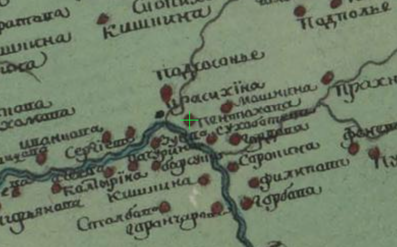

# 1786 Геометрическая карта Псковскаго наместничества (на сайте retromap.ru), окрестности Горелика (M1000)

**Полное описание:** «Геометрическая карта Псковскаго наместничества», 1786 г. Карта опубликована на сайте Retromap (retromap.ru) и наложена на современную карту, поэтому её можно сравнивать с нынешней местностью.

Ссылка на нужное место карты (открывается сразу на месте деревни Горелик): [retromap.ru](https://retromap.ru/1417864_z13_56.941603,28.897991&w=sm){ target="_blank" rel="noopener" }.

Название карты и что на ней подписано — по наблюдению составителя (2026-11-07); сайт не отдаёт страницу для автоматического чтения, поэтому выходные данные карты (масштаб, составитель, где хранится оригинал) здесь пока не приведены.

## Что видно на карте

Фрагмент карты на сайте retromap.ru; зелёный крестик — место нынешней деревни Горелик (снимок экрана составителя).

**Деревни Горелик на карте нет.** На её месте — «Пентахова»; рядом подписаны «Красихина», «Сухобреева», «Машкина (Машнина)» и река Шесть (прочтение подписей — составителя).

## Вывод составителя

Это вывод составителя, а не прямое свидетельство документа.

Горелик раньше назывался Пентахово (Пентехово): на карте 1786 г. Пентахова стоит там, где сейчас Горелик. Это как минимум соседние места, а скорее всего — одна и та же деревня. Это сходится с переписью 1709 г., где в Ильинской губе записана «деревня что была пустошь Пентехово Петрово Горелой Мостъ тожъ, на рѣчкѣ Шести» с двором Федота Артемьева [A1292], а Федот Артемьев в 1719 г. записан уже в деревне Горелик [A1275].

Возможно и другое объяснение: рядом с Пентеховым был какой-то сгоревший («горелый») мост, по которому место называли «Петрово Горелой Мост», а позже от него пошло название Горелик.

## Связанные места

- [Горелик](PLC1015)
- [Красихино](PLC1012)
