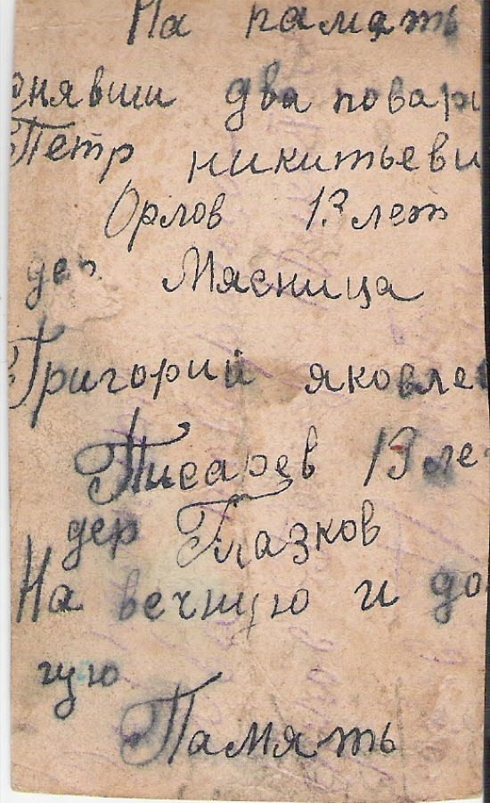

# 1932 Фотография Г. Я. Писарева и П. Н. Орлова (дата приблизительная; надпись на обороте) (F1002)

{ width="320" }

Оборот снимка, на котором сфотографированы два тринадцатилетних товарища — Пётр Никитьевич Орлов из деревни Мясница и Григорий Яковлевич Писарев из деревни [Глазков](PLC1001) (Глазки). Лицевая сторона снимка в имеющихся материалах не представлена; здесь показана надпись. Датировка 1932 г. — по составителю и по указанному в надписи возрасту (Писарев родился в 1919 г.).

Надпись на обороте (чернила; прочтение составителем по скану):

> На память 
> снявши два това[рища] 
> Петр Никитьевич 
> Орлов 13 лет 
> дер. Мясница 
> Григорий Яковлев[ич] 
> Писарев 13 лет 
> дер. Глазков 
> На вечную и до- 
> гую 
> Память

Пояснения к прочтению:

- «Глазков» — так в надписи; в документах военного времени деревня называется Глазки [A1038]. Мясница — соседняя деревня Оленинского района.
- «До-гую» — «долгую».
- Файл в личной библиотеке автора сайта: `1932_podpis_na_photo.tif`.

## Связанные персоны

- [P1007]
