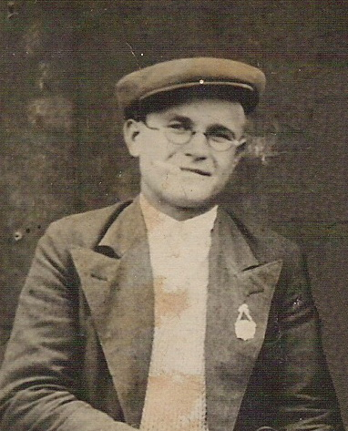

# 1940 Фотография Г. Я. Писарева и С. П. Кузьмина, пос. Дятлово (F1003)

{ width="300" }

*Фрагмент снимка: Григорий Яковлевич Писарев.*

{ width="320" }

Снимок сделан в посёлке Дятлово (ныне Нелидовский район Тверской области) в 1940 г.: на нём Г. Я. Писарев и Сергей Кузьмин. Молодой человек в кепке, очках, пиджаке и светлой вязаной рубашке, на лацкане — значок.

Надпись на обороте (карандаш, год — чернилами; прочтение составителем по скану):

> | Строка | Текст |
> |---|---|
> | 1 | Писарев Григорий |
> | 2 | Яковлевич |
> | 3 | Кузмин Сергей |
> | 4 | Пименович [?] |
> | 5 | фотографировались |
> | 6 | в пос. Дятлово |
> | 7 | 1940 году |

Пояснения к прочтению:

- Отчество Кузьмина читается неуверенно: «Пименович» или «Пимонович».
- Дятлово — посёлок, где в 1943 г. жила мать Писарева, Ксения Антоновна [A1038].
- Файлы в личной библиотеке автора сайта: `1940_PisarevGrigYak.jpg` (фрагмент с Г. Я. Писаревым) и `1940_podpis_na_photo.tif` (оборот).

## Связанные персоны

- [P1007]
