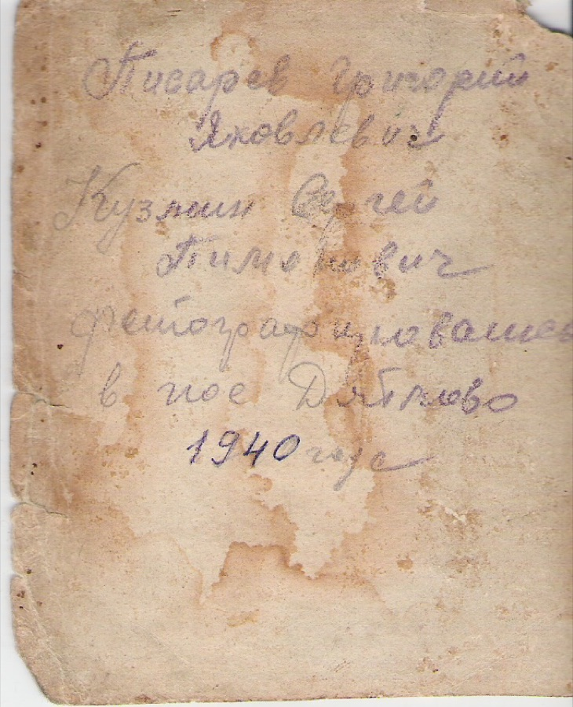

# 1940 Фотография Г. Я. Писарева и С. П. Кузьмина, пос. Дятлово (F1003)

{ width="320" }

Снимок сделан в посёлке Дятлово (ныне Нелидовский район Тверской области) в 1940 г.: на нём Г. Я. Писарев и Сергей Кузьмин. Лицевая сторона снимка на сайте не публикуется — у составителя есть фото; здесь показан оборот с надписью.

Надпись на обороте (карандаш, год — чернилами; прочтение составителем по скану):

> Писарев Григорий 
> Яковлевич 
> Кузмин Сергей 
> Пименович [?] 
> фотографировались 
> в пос. Дятлово 
> 1940 года

Пояснения к прочтению:

- Отчество Кузьмина читается неуверенно: «Пименович» или «Пимонович».
- Дятлово — посёлок, где в 1943 г. жила мать Писарева, Ксения Антоновна [A1038].
- Файлы в личной библиотеке автора сайта: `1940_PisarevGrigYak.jpg` (фрагмент с Г. Я. Писаревым) и `1940_podpis_na_photo.tif` (оборот).

## Связанные персоны

- [P1007]
