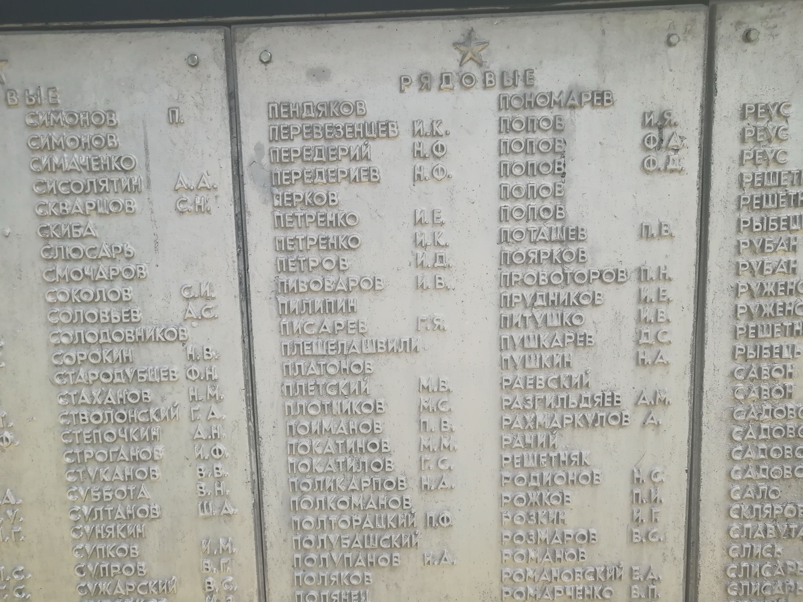

# 2020 Братская могила в с. Оскол (бывш. Красный Оскол), 28 июня (F1004)

Два снимка, сделанные Павлом П., автором сайта и внуком Г. Я. Писарева, 28 июня 2020 г., когда он нашёл и посетил братскую могилу, где похоронен его дед [Г. Я. Писарев](P1007). Село Красный Оскол Изюмского района Харьковской области с 2016 г. называется Оскол.

## Мемориал

Вдоль мощёной дорожки тянется длинная стена с плитами, на которых выбиты имена похороненных. Перед ней — два белых обелиска на чёрных постаментах, несколько отдельных надгробий и чёрная гранитная стела с гравировкой: солдат с плащ-палаткой держит на руках ребёнка (по мотивам памятника воину-освободителю в Трептов-парке, Берлин). За стелой виден край второй стелы с надписью на русском языке; в кадр попали только начала строк.

Ближний обелиск поставлен не воинам 1943 г., а членам сельского ревкома, погибшим в 1920 г. (во время Гражданской войны). Надпись на нём (на украинском языке; прочтение составителем по снимку):

> | Строка | Текст |
> |---|---|
> | 1 | Вшановуємо пам'ять звірськи забитих товаришів, які загинули в 1920 році за справу пролетарської революції в селі Червоний Оскіл. |
> | 2 | Скрипка Павло Карпович, народження 1890 р. — голова Червонооскільського ревкому. |
> | 3 | Кижняк Степан Петрович, народження 1894 р. — член сільського ревкому. |
> | 4 | Спіть спокійно, дорогі товариші. Почата вами справа буде доведена до переможного кінця. |

Перевод: «Чтим память зверски убитых товарищей, погибших в 1920 году за дело пролетарской революции в селе Красный Оскол. Скрипка Павел Карпович, 1890 г. р. — председатель Краснооскольского ревкома. Кижняк Степан Петрович, 1894 г. р. — член сельского ревкома. Спите спокойно, дорогие товарищи. Начатое вами дело будет доведено до победного конца».

Пояснения к прочтению:

- Ревком — революционный комитет, временный орган советской власти в годы Гражданской войны.
- Год «1920» в первой строке читается неуверенно.
- На надгробии за обелиском — портрет в генеральской форме и надпись «Генерал-майор Онуфриев Александр Алексеевич»; даты под именем на снимке не читаются.
- Учётная карточка 1991 г. описывает братскую могилу как железобетонный обелиск со звездой высотой 2,27 м [A1040]. Стена с именными плитами и гранитные стелы на снимке 2020 г. в ней не упомянуты — вероятно, мемориал перестраивали после 1991 г.

## Мемориальная доска

Одна из плит стены: под звездой — заголовок «РЯДОВЫЕ», ниже фамилии с инициалами по алфавиту, в два столбца. В левом столбце, одиннадцатым сверху, — «ПИСАРЕВ Г. Я.»

{ width="600" }

Фрагмент плиты (прочтение по снимку):

> | Фамилия | Инициалы |
> |---|---|
> | ПИВОВАРОВ | И. В. |
> | ПИЛИПИН | |
> | ПИСАРЕВ | Г. Я. |
> | ПЛЕШЕЛАШВИЛИ | |
> | ПЛАТОНОВ | |
> | ПЛЕТСКИЙ | М. В. |

Пояснения к прочтению:

- Соседние фамилии идут в том же порядке, что и в поимённом списке захоронения 1991 г. (№ 534–540: Пивоваров, Пилипин, Писарев, Писклов, Пкешевашвили, Платонов, Плетский) [A1040]. Сержанта Писклова на плите рядовых нет — младшие командиры, видимо, перечислены на другой плите. Грузинская фамилия в списке напечатана «Пкешевашвили», на плите — «Плешелашвили».

Файлы в личной коллекции Павла П.: `IMG_20200628_123600.jpg` (мемориал; для сайта обрезан справа) и `IMG_20200628_123202.jpg` (плита).

## Связанные персоны

- [P1007]
